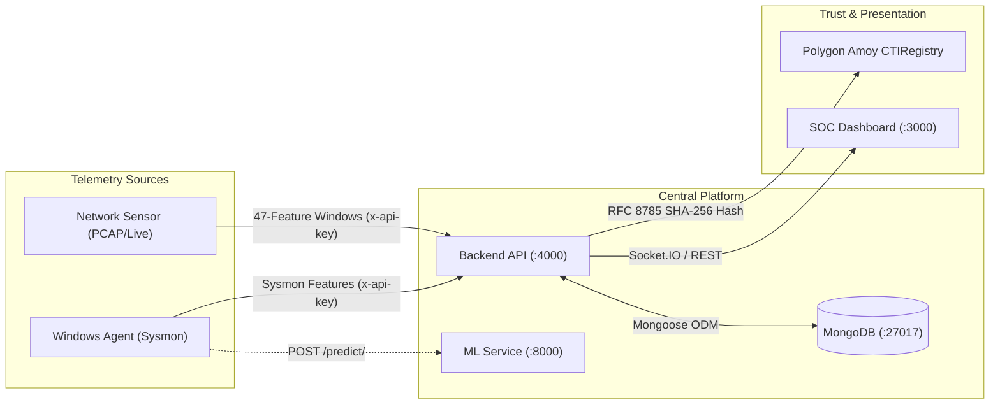

# SentinelIQ

> Autonomous multi-threat detection, automated response, and blockchain-anchored Cyber Threat Intelligence (CTI) platform

[](https://nodejs.org/)
[](https://www.typescriptlang.org/)
[](https://nextjs.org/)
[](https://www.python.org/)
[](https://fastapi.tiangolo.com/)
[](https://www.mongodb.com/)
[-8247E5?logo=polygon&logoColor=white)](https://amoy.polygonscan.com/)

---

## Table of Contents

- [1. Project Title & Overview](#1-project-title--overview)
- [2. Architecture & Tech Stack](#2-architecture--tech-stack)
- [3. Prerequisites & Environment Setup](#3-prerequisites--environment-setup)
- [4. Installation & Getting Started](#4-installation--getting-started)
- [5. Usage & API Reference](#5-usage--api-reference)

---

## 1. Project Title & Overview

### Project Name
**SentinelIQ** — Autonomous Multi-Threat Detection & Blockchain-Anchored CTI Platform.

### Value Proposition
SentinelIQ unifies endpoint behavioral telemetry and network packet monitoring to detect ransomware and DoS attacks in real time, automate containment, and anchor tamper-proof threat intelligence advisories directly onto the public blockchain.

### Key Features
- **Behavioral Ransomware Detection**: Extracts 21 host features from Windows Sysmon over 10-second sliding windows, scored by an XGBoost model with Exponential Moving Average (EMA) smoothing ($\alpha = 0.4$).
- **Rule-Based Privilege Escalation Engine**: Deterministic detection across 6 heuristic rules (`PE-01` to `PE-06`) targeting LOLBins, UAC registry hijacking, token impersonation, and unauthorized service creation.
- **Network DoS/DDoS Detection**: Ingests offline PCAP captures or live packet streams, extracting 47 statistical features per 5-second window to detect volumetric flood episodes.
- **Contextual MITRE ATT&CK Mapping**: Automatically correlates detections to official ATT&CK techniques (`T1486`, `T1490`, `T1068`, `T1548.002`, `T1498`) with clear forensic reasons.
- **Automated Response & Containment**: Rule engine evaluates risk conditions to isolate compromised endpoints safely, while keeping network DoS alerts strictly alert-only.
- **Multi-Host Cascade Correlation**: Identifies lateral movement and coordinated C2 campaigns across endpoints within a sliding 120-second temporal window.
- **Blockchain CTI Hash Anchoring**: Formats threat advisories into RFC 8785 deterministic canonical JSON and anchors their SHA-256 digest on Polygon Amoy for tamper-evident verification.
- **Real-Time SOC Dashboard**: Modern Next.js 15 interface providing live incident triage, forensic timeline inspection, and WebSocket alert feeds.

---

## 2. Architecture & Tech Stack

### Core Technologies

| Layer | Technology | Purpose |
|---|---|---|
| **Frontend** | Next.js 15.1, React 19, Tailwind CSS v4 | SOC analyst dashboard, real-time metrics, incident triage |
| **Backend API** | Node.js 20+, Express.js 4, TypeScript 5.5 | REST routes, telemetry ingestion, policy engine, Socket.IO server |
| **Persistence** | MongoDB 7.0, Mongoose ODM | Multi-tenant storage for endpoints, detections, policies, and CTI reports |
| **ML Microservice** | Python 3.11+, FastAPI, Uvicorn, XGBoost | High-performance inference microservice for host behavioral features |
| **Endpoint Agent** | Python 3.11+, PyWin32 (`win32evtlog`), XGBoost | Windows Sysmon event processing, sliding window buffer, safe isolation |
| **Network Sensor** | Python 3.11+, Scapy, Npcap (optional) | 5-second window aggregator (47 features) and DoS episode classification |
| **Blockchain** | Solidity 0.8.28, Hardhat 3, Ethers.js v6 | `CTIRegistry.sol` contract deployed on Polygon Amoy (Chain ID 80002) |

### System Design



1. **Ingest**: The Windows Agent and Network Sensor collect system events and network traffic, computing sliding behavioral windows.
2. **Analyze**: Inbound telemetry is scored by XGBoost models, checked against deterministic heuristics, and deduplicated via `sourceAlertKey`.
3. **Act**: The policy engine triggers automated containment (endpoint isolation) and cross-endpoint cascade correlation.
4. **Anchor & Display**: Confirmed incidents are published as RFC 8785 canonical CTI reports anchored on Polygon Amoy, and pushed live to the analyst dashboard.

### Dependencies
- **Microsoft Sysmon**: Required for live endpoint event collection on Windows hosts.
- **Npcap** (WinPcap-compatible mode): Required only if performing live wire network capture.
- **Polygon Amoy RPC**: Testnet RPC endpoint (`https://polygon-amoy-bor-rpc.publicnode.com`) for smart contract interactions.
- **MongoDB 7.0**: Primary document database.

---

## 3. Prerequisites & Environment Setup

### System Requirements
- **Node.js**: `v20.x` or `v22.x` (Hardhat requires Node 20+)
- **Python**: `v3.11.x` or `v3.12.x` (64-bit)
- **MongoDB**: `v7.0+` (local service or Docker container)
- **Operating System**: Windows 10/11 (for live Windows Agent / Sysmon; Linux/macOS supported for Backend, Web, Sensor, and ML Service)
- **Git**: Installed and on system PATH

### Environment Variables

#### Backend (`apps/backend/.env`)
```bash
PORT=4000
NODE_ENV=development
MONGO_URI=mongodb://127.0.0.1:27017/ransomware_cti
CORS_ORIGIN=http://localhost:3000

JWT_ACCESS_SECRET=
JWT_REFRESH_SECRET=
JWT_ACCESS_EXPIRES_IN=15m
JWT_REFRESH_EXPIRES_IN=7d

ML_SERVICE_API_KEY=sentineliq_ml_service_key_dev

POLYGON_AMOY_RPC_URL=https://polygon-amoy-bor-rpc.publicnode.com
CTI_REGISTRY_CONTRACT_ADDRESS=0xAAc39CC2A0B2A37F85bD56421483475c36295beb
CTI_REGISTRY_DEPLOY_BLOCK=50431439
BLOCKCHAIN_PRIVATE_KEY=
```

#### ML Microservice (`apps/ml-service/.env`)
```bash
ML_SERVICE_PORT=8000
BACKEND_API_URL=http://localhost:4000
BACKEND_API_KEY=sentineliq_ml_service_key_dev
```

#### Windows Agent (`agent/.env`)
```bash
BACKEND_API_URL=http://localhost:4000
BACKEND_API_KEY=sentineliq_ml_service_key_dev
ML_SERVICE_URL=http://localhost:8000

ORGANIZATION_ID=
ENDPOINT_ID=
TELEMETRY_MODE=real
AUTO_REPORT_DETECTIONS=true
PRIVILEGE_ESCALATION_DETECTION=true
```

### Global Tools
- **npm** (included with Node.js)
- **Python venv** (included with standard Python 3.11+)
- **Docker Desktop** (optional, for running MongoDB in a container)

---

## 4. Installation & Getting Started

### Cloning
```bash
git clone https://github.com/naajissiddiqui/SentinelIQ.git
cd SentinelIQ
```

### Dependency Installation

```powershell
# 1. Install Node.js dependencies and build shared packages
npm install
npm --workspace=packages/shared-types run build

# 2. Set up ML Microservice Python environment
cd apps\ml-service
python -m venv .venv
.\.venv\Scripts\pip install -r requirements.txt
cd ..\..

# 3. Set up Network Sensor Python environment
cd sensor
python -m venv .venv
cd ..

# 4. Set up Windows Agent Python environment
cd agent
python -m venv .venv
.\.venv\Scripts\pip install -r requirements.txt
cd ..
```

### Local Execution

Ensure MongoDB is running locally (`mongod` or Docker on port 27017):

```powershell
# Terminal 1: Backend API (:4000)
npm run dev:backend

# Terminal 2: Web Dashboard (:3000)
npm run dev:web

# Terminal 3: ML Microservice (:8000)
cd apps\ml-service
.\.venv\Scripts\uvicorn.exe app.main:app --host 0.0.0.0 --port 8000 --reload
```

*To seed initial demo accounts (`sarah@brightpath.com` / `DemoPass123!`):*
```powershell
npm run seed
```

### Testing
```powershell
# Run the complete 21-stage automated release verification suite
npm run release:check

# Web UI unit tests
npm --workspace=apps/web test

# Backend unit & local Hardhat chain tests
npm --workspace=apps/backend run test:anchor

# Smart contract tests
npm run test:blockchain

# Sensor unit tests (136 tests)
cd sensor && ..\apps\ml-service\.venv\Scripts\python.exe -m unittest discover -s tests -t . && cd ..

# Agent unit tests (39 tests)
cd agent && .\.venv\Scripts\python.exe -m unittest discover -s tests -p "test_*.py" && cd ..
```

---

## 5. Usage & API Reference

### Basic Examples

#### Safe Recorded Traffic Replay
Replay pre-scored CIC-DDoS2019 alert episodes into the live backend without needing kernel packet drivers:
```powershell
npm run replay:recorded -- --email sarah@brightpath.com
```

#### Run Windows Agent in Simulation Mode
Test detection and automated isolation safely in userland without modifying actual system firewall rules:
```powershell
cd agent
.\.venv\Scripts\python.exe main.py --mode simulated --scenario ransomware
```

### Common Commands

| Command | Description |
|---|---|
| `npm run dev:backend` | Starts Express backend in reload mode (`http://localhost:4000`) |
| `npm run dev:web` | Starts Next.js dashboard server (`http://localhost:3000`) |
| `npm run build` | Compiles shared types, backend TypeScript, and Next.js production build |
| `npm run seed` | Seeds database with demo organizations, endpoints, and default policies |
| `npm run replay:recorded` | Forwards pre-computed network DoS alerts through the real ingestion API |
| `npm run release:check` | Runs typechecks, builds, and all test suites on an isolated test database |
| `npm run test:blockchain` | Compiles and executes CTIRegistry Solidity contract tests on Hardhat |

### Endpoint Summary

| Method | Endpoint | Auth | Description / Key Payload |
|---|---|---|---|
| `POST` | `/api/auth/login` | Public | Sign in user. Body: `{ email, password }` -> returns JWT |
| `POST` | `/api/endpoints/activate` | Token | Activate endpoint with token. Body: `{ activationToken }` |
| `POST` | `/api/endpoints/:id/heartbeat` | Service Key | Agent metrics check-in. Body: `{ cpuUsagePercent, ramUsagePercent }` |
| `POST` | `/api/endpoints/:id/isolate` | Bearer JWT | Isolate endpoint. Roles: `ORG_ADMIN`, `SECURITY_ANALYST` |
| `POST` | `/api/detections/ingest` | Service Key | Ingest telemetry alert. Body: `{ organizationId, endpointId, attackType, riskScore, indicators, evidence, mitre }` |
| `GET` | `/api/detections` | Bearer JWT | List detections. Query params: `?scope=incidents` or `?scope=test` |
| `GET` | `/api/detections/:id` | Bearer JWT | Get detection detail, raw evidence fields, and MITRE mapping |
| `POST` | `/api/cti` | Bearer JWT | Generate CTI report draft. Body: `{ detectionId }` |
| `PATCH` | `/api/cti/:id` | Bearer JWT | Update draft notes, summary, IOCs, and recommended actions |
| `POST` | `/api/cti/:id/publish` | Bearer JWT | Publish & anchor RFC 8785 hash on Polygon Amoy |
| `GET` | `/api/cti/:id/verify` | Bearer JWT | Run 3-way hash verification against on-chain CTIRegistry record |
| `POST` | `/api/cti/:id/share` | Bearer JWT | Update sharing scope: `{ visibility: "SHARED_SELECTED"|"SHARED_ALL" }` |
| `POST` | `/api/policies` | Bearer JWT | Create automated response policy with condition trees |
