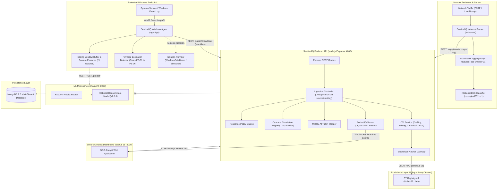
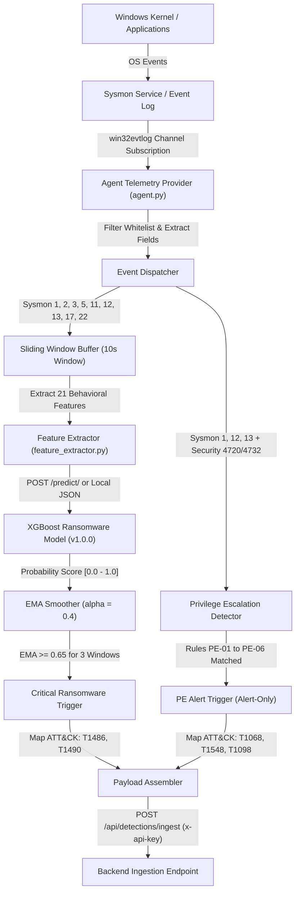
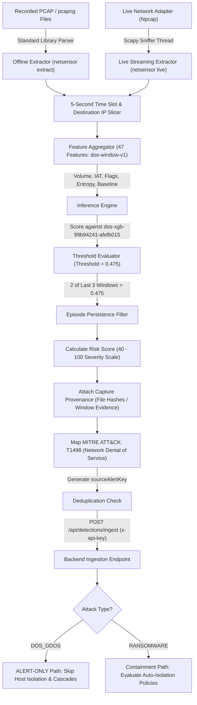
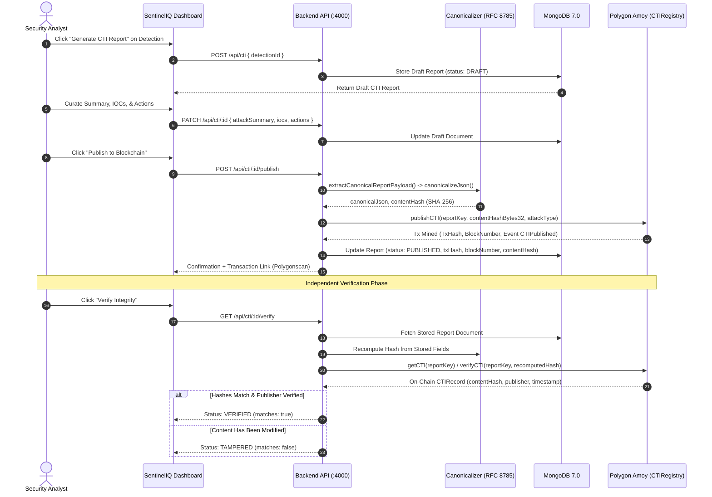

# SentinelIQ

> **Autonomous Multi-Threat Detection, Telemetry Ingestion, and Blockchain-Anchored Cyber Threat Intelligence (CTI) Platform**

[](https://nodejs.org/)
[](https://www.typescriptlang.org/)
[](https://nextjs.org/)
[](https://react.dev/)
[](https://www.python.org/)
[](https://fastapi.tiangolo.com/)
[](https://www.mongodb.com/)
[](https://xgboost.readthedocs.io/)
[](https://soliditylang.org/)
[-8247E5?logo=polygon&logoColor=white)](https://amoy.polygonscan.com/)
[](#)

---

## Table of Contents

- [1. Project Overview](#1-project-overview)
  - [Problem Statement](#problem-statement)
  - [Core Objectives](#core-objectives)
  - [Key Capabilities](#key-capabilities)
  - [What Differentiates SentinelIQ](#what-differentiates-sentineliq)
  - [Verified Project Summary](#verified-project-summary)
- [2. System Architecture](#2-system-architecture)
  - [High-Level Architecture Diagram](#high-level-architecture-diagram)
  - [Component Responsibilities & Communication Flow](#component-responsibilities--communication-flow)
  - [Service Ports and Dependencies](#service-ports-and-dependencies)
- [3. Detection Pipeline and Methodology](#3-detection-pipeline-and-methodology)
  - [Windows Host Telemetry (Sysmon)](#windows-host-telemetry-sysmon)
  - [Endpoint Feature Extraction and Ransomware ML Detection](#endpoint-feature-extraction-and-ransomware-ml-detection)
  - [Rule-Based Privilege Escalation Detection](#rule-based-privilege-escalation-detection)
  - [Network Packet Processing & DoS/DDoS Detection](#network-packet-processing--dosddos-detection)
  - [Data Provenance: Offline PCAP Replay vs. Live Wire Capture](#data-provenance-offline-pcap-replay-vs-live-wire-capture)
  - [Alert Grouping, Persistence, and Deduplication](#alert-grouping-persistence-and-deduplication)
  - [Detection Pipelines Visualized](#detection-pipelines-visualized)
- [4. Backend, CTI and Blockchain](#4-backend-cti-and-blockchain)
  - [Backend Architecture & Ingestion Flow](#backend-architecture--ingestion-flow)
  - [Authentication, RBAC & Machine Identity](#authentication-rbac--machine-identity)
  - [Endpoint Lifecycle & Heartbeats](#endpoint-lifecycle--heartbeats)
  - [Policy Engine & Automated Containment](#policy-engine--automated-containment)
  - [Multi-Host Cascade Correlation](#multi-host-cascade-correlation)
  - [Cyber Threat Intelligence (CTI) Lifecycle](#cyber-threat-intelligence-cti-lifecycle)
  - [RFC 8785 Canonical Serialization & SHA-256 Hashing](#rfc-8785-canonical-serialization--sha-256-hashing)
  - [Blockchain Smart Contract (Polygon Amoy CTIRegistry)](#blockchain-smart-contract-polygon-amoy-ctiregistry)
  - [Cryptographic Verification: What Blockchain Proves vs. Does Not Prove](#cryptographic-verification-what-blockchain-proves-vs-does-not-prove)
  - [CTI Publishing & Verification Workflow Diagram](#cti-publishing--verification-workflow-diagram)
  - [Representative API Endpoints](#representative-api-endpoints)
- [5. Technology Stack and Project Structure](#5-technology-stack-and-project-structure)
  - [Technology Stack Breakdown](#technology-stack-breakdown)
  - [Repository Folder Structure](#repository-folder-structure)
- [6. Setup, Execution and Future Scope](#6-setup-execution-and-future-scope)
  - [Prerequisites](#prerequisites)
  - [Environment Configuration](#environment-configuration)
  - [Installation & Dependency Setup](#installation--dependency-setup)
  - [Service Startup Guide](#service-startup-guide)
  - [Running the Detection Pipelines](#running-the-detection-pipelines)
  - [Automated Verification and Test Suites](#automated-verification-and-test-suites)
  - [Common Troubleshooting](#common-troubleshooting)
  - [Current Implementation Status](#current-implementation-status)
  - [Known Engineering Limitations](#known-engineering-limitations)
  - [Future Scope](#future-scope)

---

## 1. Project Overview

### Problem Statement

Modern enterprise environments face an escalating convergence of endpoint and perimeter threats:

1. **Evasive Ransomware**: Fast-moving encryption payloads modify file access patterns, hijack system processes, and disable recovery points (e.g., Volume Shadow Copies) faster than human security analysts can manually respond.
2. **Silent Privilege Escalation**: Attackers exploit User Account Control (UAC) bypasses, unquoted service paths, token impersonation, and Image File Execution Options (IFEO) to pivot from unprivileged user accounts to `NT AUTHORITY\SYSTEM`.
3. **High-Rate Denial of Service (DoS/DDoS)**: Volumetric floods (such as TCP SYN floods or UDP floods) overwhelm network boundaries, exhausting connection tables and socket pools.
4. **CTI Tampering and Inter-Organizational Distrust**: When organizations exchange Cyber Threat Intelligence (CTI) reports regarding active attacks, recipients have no trustless mechanism to verify that an advisory was not modified, falsified, or retroactively edited after publication.

### Core Objectives

SentinelIQ was engineered as a multi-tier detection, response, and intelligence platform designed to:

- Ingest structured endpoint behavior from Microsoft Sysmon without relying on brittle static signatures.
- Extract high-dimensional behavioral feature vectors across sliding windows to classify ransomware with machine learning.
- Execute deterministic, rule-based detection for Windows privilege escalation chains with zero false-positive tolerance.
- Extract bidirectional flow and window features from network packet captures (PCAP) to detect volumetric DoS/DDoS attacks.
- Enforce automated, policy-driven containment actions (such as safe endpoint network isolation) while isolating DoS/DDoS alerts from destructive containment.
- Compile confirmed security incidents into structured CTI incident reports conforming to RFC 8785 JSON Canonicalization.
- Anchor cryptographic content hashes on an immutable public blockchain ledger (Polygon Amoy) to guarantee report provenance and tamper-evident inter-organization sharing.

### Key Capabilities

| Capability | Technical Mechanism | Implementation State |
|---|---|---|
| **Host Ransomware Detection** | 21-feature behavioral extraction across 10-second sliding windows, scored by an XGBoost classifier with Exponential Moving Average (EMA) smoothing ($\alpha = 0.4$). | Fully Implemented & Trained |
| **Host Privilege Escalation Detection** | 6 deterministic heuristic detection rules inspecting Sysmon and Windows Security event logs for LOLBins, UAC bypasses, token theft, and service tampering. | Fully Implemented |
| **Network DoS/DDoS Detection** | 47-feature `dos-window-v1` schema calculated across 5-second per-destination slots, scored by an XGBoost model trained on CIC-DDoS2019 traffic. | Fully Implemented & Evaluated |
| **MITRE ATT&CK Mapping** | Automated contextual technique mapping (`T1486`, `T1490`, `T1083`, `T1068`, `T1548.002`, `T1498`, etc.) with explicit evidence correlation. | Fully Implemented |
| **Automated Response Policies** | Rule engine evaluating conditions against risk scores, attack types, and IOC matches to trigger endpoint isolation or severity escalation. | Fully Implemented |
| **Multi-Host Cascade Correlation** | Temporal clustering across a 120-second sliding window to identify ransomware lateral propagation or coordinated C2 bursts. | Fully Implemented |
| **Blockchain CTI Hash Anchoring** | Smart contract (`CTIRegistry.sol`) on Polygon Amoy recording SHA-256 digests of RFC 8785 canonical JSON CTI advisories. | Deployed on Polygon Amoy |
| **Tamper-Evident Verification** | On-demand three-way verification comparing database state, canonical recomputed hash, and on-chain contract state. | Fully Implemented |
| **Real-Time SOC Dashboard** | Next.js 15 dashboard receiving live telemetry and alert broadcasts via authenticated Socket.IO rooms. | Fully Implemented |

### What Differentiates SentinelIQ

Traditional endpoint monitoring tools operate as passive log collectors or rely on static hashing (e.g., comparing file MD5/SHA256 sums against known virus databases). SentinelIQ differs fundamentally in four key dimensions:

1. **Behavioral Dynamics over Static Signatures**: Rather than matching static file hashes or known malicious command-line strings, SentinelIQ computes statistical rates (file activity rate, directory entropy, pipe creation rate, distinct source port distributions) over time windows.
2. **Explicit Data Provenance and Scope Separation**: Detections are tagged at ingestion with their exact data origin: `LIVE`, `PCAP_REPLAY`, `SIMULATED`, or `DEMO`. The web dashboard rigorously excludes synthetic and demo records from normal production views (`scope=incidents`), preventing test artifacts from polluting production metrics.
3. **Safety-Guarded Multi-Threat Response**: Network DoS alerts are classified as `ALERT-ONLY`. While ransomware triggers automatic host isolation and moves endpoints to `AT_RISK`, network DoS alerts deliberately bypass host isolation and cascade correlation to avoid causing denial of service to protected endpoints.
4. **Cryptographic CTI Verification**: Shared CTI reports are backed by on-chain proofs on Polygon Amoy. Any security partner can independently verify that a published advisory has not been altered by an intermediary, a database administrator, or a compromised backend server.

### Verified Project Summary

- **Total Automated Test Suite**: 21 of 21 test stages pass in `npm run release:check` across TypeScript unit/build suites, Next.js production builds, local Hardhat chain suites, disposable MongoDB integration suites, 136 network sensor unit tests, and 39 Windows agent unit tests.
- **On-Chain Anchor Deployments**: Active smart contract `CTIRegistry` deployed on Polygon Amoy at `0xAAc39CC2A0B2A37F85bD56421483475c36295beb`.

---

## 2. System Architecture

### High-Level Architecture Diagram



### Component Responsibilities & Communication Flow

#### 1. Windows Endpoint Agent (`agent/`)
- **Technology**: Python 3.11+, `pywin32` (`win32evtlog`), `xgboost`, `requests`.
- **Role**: Operates directly on monitored Windows hosts with administrative privileges.
- **Workflow**:
  - Connects to the Windows Event Log channel `Microsoft-Windows-Sysmon/Operational` via `win32evtlog.EvtRender`.
  - Normalizes raw XML events into unified event dictionaries (Process Create, File Create, Registry SetValue, Named Pipe, DNS query).
  - Feeds process-specific events into a sliding window buffer (10-second duration).
  - Concurrently evaluates raw events through the 6-rule Privilege Escalation Detector (`agent/privilege_escalation.py`).
  - Periodically sends heartbeats to `POST /api/endpoints/:id/heartbeat` with CPU, RAM, and disk utilization metrics.
  - Pulls queued actions (`ISOLATE`, `UNISOLATE`) from the backend and executes them safely via `IsolationProvider`.

#### 2. Network Sensor (`sensor/`)
- **Technology**: Python 3.11+, standard library (offline extraction), Scapy & Npcap (live capture), `xgboost`, `numpy`.
- **Role**: Extracts statistical flow and window metrics from recorded PCAP/pcapng files or live network adapters.
- **Workflow**:
  - Aggregates packets into 5-second time slots grouped by destination IP.
  - Computes 47 strictly behavioral features conforming to the `dos-window-v1` schema (packet volume, inter-arrival times, protocol ratios, TCP flag distributions, source entropy, flow counts, baseline ratios).
  - Scores windows using the held-out trained model `dos-xgb-99b94241-afefb015`.
  - Groups consecutive over-threshold windows into discrete alert episodes.
  - Formats payloads with SHA-256 capture provenance and forwards them to `POST /api/detections/ingest`.

#### 3. Machine Learning Microservice (`apps/ml-service/`)
- **Technology**: Python 3.11+, FastAPI, Uvicorn, Scikit-learn, XGBoost, Pydantic v2.
- **Role**: Provides a stateless inference endpoint for endpoint behavioral feature vectors.
- **Endpoints**:
  - `POST /predict/`: Accepts 21 extracted behavioral features, runs inference against `model.pkl`, applies a 0.5 decision threshold, and returns the risk score (0–100), ransomware classification boolean, confidence, and model version.
  - `GET /health/`: Returns health status and loaded model metadata.

#### 4. Backend API & Ingestion Service (`apps/backend/`)
- **Technology**: Node.js 20+, TypeScript, Express 4, Mongoose 8, Socket.IO 4, ethers.js v6.
- **Role**: Central ingestion, correlation, policy execution, CTI compilation, and blockchain gateway.
- **Workflow**:
  - Authenticates analyst traffic via JWT access/refresh tokens in HTTP-only cookies; authenticates agents and sensors via `x-api-key`.
  - Deduplicates incoming sensor alert episodes using a deterministic `sourceAlertKey`.
  - Derives MITRE ATT&CK techniques with forensic justifications.
  - Executes response policies (e.g., auto-containment) and triggers multi-host cascade analysis.
  - Generates RFC 8785 canonical JSON summaries for CTI drafts and publishes content hashes to Polygon Amoy.
  - Emits real-time WebSocket notifications to tenant-isolated rooms (`org:<organizationId>`).

#### 5. Database Layer (`apps/backend/src/models/`)
- **Technology**: MongoDB 7.0.
- **Role**: Document store enforcing multi-tenant isolation across all collections:
  - `organizations`: Tenant account definition and sharing relationships.
  - `users`: User identities with roles (`ORG_ADMIN`, `SECURITY_ANALYST`, `SUPER_ADMIN`).
  - `endpoints`: Managed hosts, status (`PENDING`, `ONLINE`, `OFFLINE`, `AT_RISK`, `ISOLATED`), and performance metrics.
  - `detections`: Security alerts, MITRE mappings, raw evidence fields, and data origin tags.
  - `ctireports`: CTI incident reports, RFC 8785 canonical JSON, on-chain transaction hashes, and verification statuses.
  - `policies`: Configurable automated response rules with condition trees and cooldown periods.
  - `cascades`: Correlated multi-host attack cascades.
  - `auditlogs`: Immutable audit trails auto-expiring after 1 year via MongoDB TTL indexes.

#### 6. Blockchain Layer (`blockchain/`)
- **Technology**: Solidity 0.8.28, OpenZeppelin Contracts v5, Hardhat 3, Polygon Amoy Testnet.
- **Role**: Provides an immutable, append-only notice board for CTI content hashes.
- **Contract**: `CTIRegistry.sol` at `0xAAc39CC2A0B2A37F85bD56421483475c36295beb`.
- **Workflow**: Only the backend owner wallet may call `publishCTI()`. Any external party can call `verifyCTI()` or `getCTI()` without gas fees to verify report integrity.

#### 7. Security Operations Dashboard (`apps/web/`)
- **Technology**: Next.js 15.1 (App Router), React 19, Tailwind CSS v4, Lucide React, Recharts.
- **Role**: Analyst user interface for detection triage, forensic timeline inspection, endpoint isolation management, policy configuration, CTI draft curation, and blockchain verification.

### Service Ports and Dependencies

| Service / Component | Default Port / Interface | Protocol / Transport | Authentication Required | Primary Dependencies |
|---|---|---|---|---|
| **Frontend Web App** | `3000` | HTTP / WebSocket | Session JWT | Backend API (:4000) |
| **Backend API** | `4000` | HTTP / REST | Bearer JWT / Cookie | MongoDB (:27017), Polygon Amoy RPC |
| **WebSocket Server** | `4000` (Attached) | WSS / Socket.IO | Handshake JWT (`token`) | Express HTTP Server |
| **ML Microservice** | `8000` | HTTP / REST | Optional Service Key | Model Artifacts (`model.pkl`) |
| **MongoDB Instance** | `27017` | TCP / Mongo Wire | User/Pass or Local Trust | File System Storage |
| **Polygon Amoy RPC** | `80002` (Chain ID) | HTTPS / JSON-RPC | RPC URL / Private Key | Polygon Testnet Node |
| **Windows Agent** | Host Process | Outbound HTTPS | `x-api-key` / Token | Backend (:4000), ML (:8000), Sysmon |
| **Network Sensor** | Host Process | Outbound HTTPS | `x-api-key` | Backend (:4000), ML venv |

---

## 3. Detection Pipeline and Methodology

### Windows Host Telemetry (Sysmon)

The Windows agent monitors system activities by subscribing to Microsoft Sysmon (`Microsoft-Windows-Sysmon/Operational`) and standard Windows Event Logs. The agent utilizes an optimized XML configuration (`sysmonconfig-sentineliq.xml` and `sysmonconfig.xml`) tuned to filter benign noise while capturing high-fidelity indicators:

- **Sysmon Event ID 1 (Process Create)**: Monitored globally without exclusions to identify initial compromise and unauthorized script/shell executions.
- **Sysmon Event ID 2 (File Creation Time Changed)**: Tracks timestomping attempts commonly used by malware to evade chronological forensic discovery.
- **Sysmon Event ID 3 (Network Connection)**: Tracks outbound TCP connections, capturing destination IPs and ephemeral port usage.
- **Sysmon Event ID 5 (Process Terminated)**: Tracks process exit telemetry to maintain active PID lifecycle state.
- **Sysmon Event ID 11 (File Create)**: Captures file creations while filtering high-volume noisy paths (browser caches, package managers, git repositories).
- **Sysmon Event ID 12, 13, 14 (Registry Events)**: Monitors key creations, deletions, and `SetValue` operations targeted at autostart run keys and service definitions.
- **Sysmon Event ID 17, 18 (Named Pipe Events)**: Captures pipe creation and connections utilized in C2 frameworks and token impersonation.
- **Sysmon Event ID 22 (DNS Query)**: Monitors domain name resolution requests.
- **Windows Security Log (Event IDs 4720, 4728, 4732, 4756, 4697, 4698)**: Identifies local account creation, additions to `Administrators`, and scheduled task registrations.
- **Windows System Log (Event ID 7045)**: Captures newly installed Windows services.

### Endpoint Feature Extraction and Ransomware ML Detection

Feature extraction runs every 3 seconds across a 10-second sliding window per process (`agent/feature_extractor.py`). It calculates exactly 21 behavioral features designed to identify ransomware encryption activity:

| # | Feature Name | Description / Formula |
|---|---|---|
| 1 | `process_create_count` | Number of child processes spawned within the window. |
| 2 | `process_terminated_count` | Number of processes terminated by this process. |
| 3 | `file_create_count` | Count of file creation events. |
| 4 | `file_creation_time_changed` | Count of file timestomping modifications. |
| 5 | `registry_write_count` | Count of registry `SetValue` operations. |
| 6 | `pipe_create_count` | Count of named pipe creations. |
| 7 | `network_connection_count` | Outbound network connection attempts. |
| 8 | `dns_query_count` | Count of DNS lookups performed. |
| 9 | `file_activity_rate` | File events per second ($N_{\text{file}} / 10.0$). |
| 10 | `process_activity_rate` | Process events per second ($N_{\text{proc}} / 10.0$). |
| 11 | `network_activity_rate` | Network events per second ($N_{\text{net}} / 10.0$). |
| 12 | `registry_activity_rate` | Registry writes per second ($N_{\text{reg}} / 10.0$). |
| 13 | `pipe_activity_rate` | Pipe events per second ($N_{\text{pipe}} / 10.0$). |
| 14 | `unique_extensions_written` | Number of distinct file extensions modified. |
| 15 | `unique_directories_touched` | Number of distinct directory paths modified. |
| 16 | `known_encrypted_ext_count` | Files written with known ransomware extensions (`.locked`, `.encrypted`, `.wncry`, `.crypt`, etc.). |
| 17 | `file_operation_ratio` | Ratio of file events relative to total process events. |
| 18 | `file_name_entropy` | Normalized Shannon entropy of written file names ($-\sum p \log_2 p$). |
| 19 | `average_file_path_length` | Average character length of file paths touched. |
| 20 | `suspicious_path_ratio` | Proportion of modifications inside user temp/appdata paths. |
| 21 | `network_unique_destinations` | Distinct destination IP addresses contacted. |

#### Model Scoring and Temporal Smoothing
The ML model is an XGBoost binary classifier (`v1.0.0`) trained on 20,000 behavioral rows, achieving ROC-AUC 1.0 and F1 1.0 on its held-out testbed.

To prevent transient spikes from triggering false alarms, the agent maintains an Exponential Moving Average (EMA) for each active PID:
$$\text{EMA}_t = \alpha \cdot \text{Score}_t + (1 - \alpha) \cdot \text{EMA}_{t-1} \quad (\alpha = 0.4)$$

Alert thresholds are strictly graduated:
- **`NORMAL`**: $\text{EMA} < 0.50$
- **`SUSPICIOUS`**: $0.50 \le \text{EMA} < 0.65$
- **`ALERT`**: $\text{EMA} \ge 0.65$
- **`CRITICAL`**: 3 consecutive windows above $0.65$ triggers automated reporting to the backend.

### Rule-Based Privilege Escalation Detection

Privilege escalation detection (`agent/privilege_escalation.py`) runs deterministically alongside the ML pipeline. It evaluates normalized telemetry against 6 rules:

1. **PE-01: Unexpected Privileged Process Execution**
   - Detects elevated/SYSTEM processes executing out of user-writable directories (`\Users\Public\`, `\AppData\Local\Temp\`, `\Windows\Temp\`, etc.).
   - Detects SYSTEM command shells (`cmd.exe`, `powershell.exe`, `whoami.exe`) spawned by non-system-manager parents (not spawned by `services.exe`, `svchost.exe`, `msiexec.exe`, etc.).
2. **PE-02: Suspicious Parent-Child Chain Involving Elevated Execution**
   - Flags execution when a Medium/Low integrity parent spawns a SYSTEM integrity child.
   - Flags Office applications (`winword.exe`, `excel.exe`) or script interpreters (`wscript.exe`, `cscript.exe`, `mshta.exe`) spawning administrative shells.
   - Flags service accounts (`w3wp.exe`, `sqlservr.exe`, `spoolsv.exe`) spawning interactive command shells (Token impersonation / "Potato" exploit patterns).
3. **PE-03: Account / Privileged-Group Membership Changes**
   - Inspects command lines for `net user /add` or `net localgroup administrators /add`.
   - Analyzes Windows Security Event IDs 4720 (user created), 4728/4732/4756 (member added to administrative groups).
4. **PE-04: Service / Scheduled-Task Creation with Elevated Execution**
   - Monitors execution of `sc.exe create`, `schtasks.exe /create`, or PowerShell cmdlets `New-Service` / `Register-ScheduledTask`.
   - Inspects Windows System Event 7045 and Security Events 4697/4698 for service binary paths pointing to user-writable locations.
5. **PE-05: Known Privilege-Escalation / UAC-Bypass Indicators**
   - Monitors auto-elevating Windows binaries (`fodhelper.exe`, `eventvwr.exe`, `sdclt.exe`, `cmstp.exe`).
   - Detects registry key hijacking in user hives targeting elevated command execution:
     `\Software\Classes\ms-settings\Shell\Open\command`
     `\Software\Classes\mscfile\Shell\Open\command`
6. **PE-06: Suspicious Security-Related Registry Changes**
   - Detects manipulation of Image File Execution Options (IFEO) debugger keys (`Debugger` value set for accessibility binaries like `sethc.exe` or `utilman.exe`).
   - Detects disabling of Windows Defender / UAC policies via registry modifications.

> [!NOTE]
> Privilege escalation detections are configured as **ALERT-ONLY**. They generate alerts with high-confidence forensic evidence but never trigger automatic host isolation or network cutoffs.

### Network Packet Processing & DoS/DDoS Detection

The network sensor (`sensor/`) performs offline PCAP processing and live interface monitoring. Captured packets are aggregated into 5-second per-destination slots using the unified `dos-window-v1` schema (47 features):

- **Volume Features**: Inbound/outbound packets, bytes, packet rate ($\text{pkt/s}$), byte rate ($\text{B/s}$), and byte/packet ratios.
- **Packet Length Distribution**: Mean, standard deviation, minimum, maximum, 50th percentile (median), and 95th percentile lengths.
- **Inter-Arrival Times (IAT)**: Inbound packet IAT mean, standard deviation, minimum, maximum, and coefficient of variation ($CV$).
- **Protocol Distribution**: TCP share, UDP share, ICMP share, other protocol share, and IP fragment share.
- **TCP Flag Ratios**: SYN-only ratio, SYN-ACK reply ratio, RST ratio, FIN ratio, PSH ratio, and ACK-only ratio.
- **Source Diversity**: Unique source IP count, unique source /24 prefix count, normalized source IP entropy, dominant source share, unique source port count, and unique destination port count.
- **Flow Characteristics**: Active flows, new flows created, new flow rate, packets per flow (mean/std/max), bytes per flow, single-packet flow share, and unanswered flow share.
- **Baseline History Ratios**: Inbound PPS ratio, new flow rate ratio, and source count ratio relative to the host's previous 60 seconds (12 sliding windows).

#### Trained Model Specifications (`dos-xgb-99b94241-afefb015`)
- **Algorithm**: XGBoost (Single decision tree, `max_depth = 3`).
- **Learned Decision Rule**: A single high-information split:
  $$\text{unique\_src\_ports} \ge 511 \implies \text{Attack}$$
- **Threshold**: Validation-selected threshold of $0.475$.
- **Temporal Persistence Rule**: Requires $k=2$ out of the last $n=3$ consecutive 5-second windows to exceed the $0.475$ threshold for an alert episode to trigger.
- **Empirical Validation Performance**: Evaluated against the held-out CIC-DDoS2019 SYN test split:
  - **Recall**: 1.0 (95% CI: 0.959–1.0)
  - **False Positive Rate**: 0.0 (0.0–0.00011)
  - **False Alerts**: 0 false alerts across 49 benign destination-hours.
  - **Detection Delay**: 10 seconds (due to the 2-window requirement).

### Data Provenance: Offline PCAP Replay vs. Live Wire Capture

SentinelIQ enforces strict truthfulness in telemetry ingestion. Every alert payload carries a mandatory `dataOrigin` tag:

```
LIVE         -> Telemetry captured from live Windows Sysmon or live Npcap network interfaces.
PCAP_REPLAY  -> Telemetry parsed offline from pre-recorded capture files (e.g., CIC-DDoS2019 PCAP).
SIMULATED    -> In-memory synthetic telemetry produced by test simulators.
DEMO         -> Seeded baseline demonstration records.
```

- Ingestion of PCAP replays (`npm run replay:recorded`) preserves the original 2018 capture timestamps and attaches SHA-256 capture provenance evidence.
- The web dashboard filters all lists and summary cards by `scope=incidents` by default, strictly isolating test data (`scope=test`) into a separate, labeled review tab.

### Alert Grouping, Persistence, and Deduplication

1. **Episode Deduplication via `sourceAlertKey`**:
   To prevent duplicate alerts when replaying PCAP files or re-running sensors, the backend generates a deterministic SHA-256 fingerprint from:
   $$\text{Key} = \text{Hash}(\text{endpointId} + \text{dataOrigin} + \text{attackType} + \text{ruleId} + \text{modelVersion} + \text{detectedAt} + \text{target})$$
   If an alert matches an existing key, the backend returns HTTP 200 with `{ duplicate: true }` and returns the existing detection ID without modifying state.

2. **Risk Score Severity Mapping**:
   Risk scores are calculated as continuous values from $0$ to $100$ (representing severity, not probability). For network DoS:
   $$\text{RiskScore} = \text{round}(40 + 20 \cdot \text{margin} + 20 \cdot \text{persistence} + 20 \cdot \text{volume})$$
   - $\text{Score} \ge 90 \implies \mathbf{CRITICAL}$
   - $70 \le \text{Score} < 90 \implies \mathbf{HIGH}$
   - $40 \le \text{Score} < 70 \implies \mathbf{MEDIUM}$
   - $\text{Score} < 40 \implies \mathbf{LOW}$

### Detection Pipelines Visualized

#### 1. Endpoint Threat Detection Pipeline



#### 2. Network Threat Detection Pipeline



---

## 4. Backend, CTI and Blockchain

### Backend Architecture & Ingestion Flow

The SentinelIQ backend is structured as a layered Express.js application written in TypeScript (`apps/backend/src/`). Ingestion follows a strict transactional flow:

1. **Authentication Gate**: External API calls from agents or sensors require the `x-api-key` header (matching `ML_SERVICE_API_KEY`). User requests require a signed JWT access token.
2. **Deduplication Check**: Inbound payloads generate a `sourceAlertKey`. If an alert episode exists for this tenant, ingestion returns HTTP 200 immediately.
3. **Indicator Threat Intel Cross-Correlation**: Ingested indicators are cross-referenced with `threatIntelService`. If `THREAT_INTEL_IOC_FILE` is configured, matched indicators attach threat intelligence metadata to the detection record.
4. **MITRE ATT&CK Mapping**: Mappings are attached with an explicit `mappingReason` stating which observed indicators or rules justified each technique.
5. **Detection Record Persistence**: The detection document is created with calculated severity, evidence arrays, and initial status `NEW`.
6. **Host Status & Forensic Timeline**: For ransomware, the target endpoint is transitioned to `AT_RISK` and a forensic timeline event is written to MongoDB. For DoS/DDoS, host status is preserved.
7. **Policy Evaluation**: The condition engine executes registered automated response policies.
8. **Cascade Correlation**: Evaluates multi-host temporal clustering.
9. **Real-Time Broadcast**: The detection is broadcast via Socket.IO to the tenant's authenticated room (`org:<organizationId>`).

### Authentication, RBAC & Machine Identity

SentinelIQ enforces role-based access control (RBAC) across three human roles and a separate machine identity:

- **`ORG_ADMIN`**: Full tenant management, user management, endpoint registration/deletion, policy creation/deletion, CTI draft curation, publishing, revision, and inter-organization sharing.
- **`SECURITY_ANALYST`**: Detection triage and resolution, manual endpoint isolation/un-isolation, policy toggling, CTI draft editing, and report verification.
- **`SUPER_ADMIN`**: Global platform administrative view across organizations.
- **Machine Service Key (`x-api-key`)**: Dedicated shared secret for machine-to-machine telemetry ingestion (`/api/detections/ingest`), endpoint heartbeats (`/api/endpoints/:id/heartbeat`), and action acknowledgments (`/api/endpoints/:id/actions/:actionId/ack`).

JWT authentication uses dual tokens:
- **Access Token**: Short-lived (15 minutes), passed via `Authorization: Bearer <token>` or HTTP-only cookies.
- **Refresh Token**: Long-lived (7 days), stored in a secure cookie to allow background token renewal via `POST /api/auth/refresh-token`.

### Endpoint Lifecycle & Heartbeats

Endpoints transition across five explicit lifecycle states:

```
PENDING  --> Activated with one-time token -->  ONLINE  <-->  AT_RISK
                                                  |             |
                                            (Isolation)   (Isolation)
                                                  v             v
                                              ISOLATED <--------+
                                                  |
                                             (Unisolate)
                                                  v
                                               ONLINE
                                                  |
                                          (Missed Heartbeat)
                                                  v
                                               OFFLINE
```

- **Activation**: New endpoints are created in `PENDING` state with an activation token (`SENTIQ-...`). The agent boots, calls `POST /api/endpoints/activate`, exchanges the token for host configuration (`organizationId`, `endpointId`), and transitions to `ONLINE`.
- **Heartbeat Monitoring**: Agents send heartbeats every 30 seconds (`POST /api/endpoints/:id/heartbeat`) protected by rate-limiting middleware (`heartbeatLimiter`).
- **Action Polling & Acknowledgment**: Isolation commands (`ISOLATE`, `UNISOLATE`) are queued as `EndpointAction` records. The agent retrieves pending actions during polling, executes the local isolation provider, and acknowledges completion via `POST /api/endpoints/:id/actions/:actionId/ack`.

### Policy Engine & Automated Containment

The policy engine (`apps/backend/src/services/policy.service.ts`) executes automated response actions based on configurable rule trees:

- **Condition Evaluation**: Evaluates conditions combining fields (`riskScore`, `severity`, `detectionType`, `consecutiveDetections`, `ctiMatch`, `affectedEndpointCount`) with operators (`EQUALS`, `NOT_EQUALS`, `GREATER_THAN_OR_EQUAL`, etc.) using `AND` / `OR` logic.
- **Actions Supported**:
  - `ISOLATE_ENDPOINT`: Triggers network containment.
  - `MARK_HIGH_RISK`: Escalates detection severity to `CRITICAL`.
- **Safety Guards**:
  - `isActionAllowed()` blocks host isolation for `DOS_DDOS` detections regardless of policy configuration.
  - Policies enforce a cooldown period (`cooldownPeriodSeconds`) to prevent containment flapping.

### Multi-Host Cascade Correlation

When ransomware spreads across an enterprise, individual endpoint alerts represent fragments of a single coordinated campaign. The cascade engine (`apps/backend/src/services/cascade.service.ts`):
- Operates across a sliding 120-second correlation window.
- Clusters detections from multiple endpoints sharing identical CTI IOC matches (`COORDINATED_C2_BURST`) or multiple high-risk detections occurring within close temporal proximity (`RANSOMWARE_PROPAGATION`).
- Groups correlated alerts into a unified `Cascade` incident document, providing a single-click containment option in the dashboard to isolate all impacted endpoints simultaneously.

### Cyber Threat Intelligence (CTI) Lifecycle

```
[Confirmed Detection]
         |
         v
 1. Generate Draft (POST /api/cti)
         |
         v
 2. Analyst Curation (PATCH /api/cti/:id) -> Edit IOCs, Summary, Actions
         |
         v
 3. Canonical Serialization (RFC 8785) & SHA-256 Digest
         |
         v
 4. Blockchain Publication (POST /api/cti/:id/publish)
         |---> Polygon Amoy: publishCTI(reportKey, contentHash, attackType)
         |
         v
 5. Inter-Org Sharing (POST /api/cti/:id/share)
         |---> PRIVATE | SHARED_SELECTED | SHARED_ALL
         |
         v
 6. On-Demand Verification (GET /api/cti/:id/verify)
         |---> Recompute Canonical Hash <===> Compare with CTIRegistry on Amoy
```

1. **Draft Generation**: Confirmed ransomware incidents can be converted into CTI drafts. The backend populates indicators, evidence, affected hosts, detector versions, and ATT&CK tactics.
2. **Analyst Review**: Security analysts update attack summaries, refine Indicators of Compromise (IOCs), and append recommended mitigation actions.
3. **Sharing Controls**:
   - `PRIVATE`: Accessible solely to the authoring organization.
   - `SHARED_SELECTED`: Explicitly shared with designated partner tenant IDs.
   - `SHARED_ALL`: Published to the global cross-organization CTI feed.
4. **Revisions**: Modifying a published report creates an explicit new version (e.g., `v2`) with a `supersedes` link to the parent report ID.

### RFC 8785 Canonical Serialization & SHA-256 Hashing

To guarantee deterministic hashing regardless of key order, whitespace, or platform-specific serialization differences, SentinelIQ implements the **RFC 8785 JSON Canonicalization Scheme (JCS)** (`apps/backend/src/utils/canonical.ts`):

- **Deterministic Sorting**: All object keys are sorted in lexicographical Unicode code unit order.
- **Whitespace Elimination**: All insignificant whitespace is removed.
- **Canonical Payload Scoping**: Transient database fields (`_id`, `__v`, `status`, `transactionHash`, `blockNumber`, `updatedAt`) are excluded. Only immutable forensic fields are preserved:
  `reportId`, `schemaVersion`, `attackType`, `title`, `detectedAt`, `severity`, `riskScore`, `confidenceTier`, `attackSummary`, `indicatorsOfCompromise` (alphabetically sorted), `recommendedActions`, `detector` metadata, canonicalized `evidence` fields, and canonicalized `mitre` mappings.
- **Hash Derivation**:
  $$\text{CanonicalJSON} = \text{JCS}(\text{Payload})$$
  $$\text{ContentHash} = \text{SHA-256}(\text{CanonicalJSON})$$
  $$\text{Bytes32} = \text{"0x"} + \text{ContentHash}$$

### Blockchain Smart Contract (Polygon Amoy CTIRegistry)

The smart contract (`blockchain/contracts/CTIRegistry.sol`) acts as a public notice board:

```solidity
contract CTIRegistry is Ownable {
    struct CTIRecord {
        bytes32 contentHash;
        address publisher;
        uint256 timestamp;
        string attackType;
    }

    mapping(bytes32 => CTIRecord) private records;

    event CTIPublished(
        bytes32 indexed reportKey,
        bytes32 contentHash,
        address indexed publisher,
        uint256 timestamp,
        string attackType
    );

    function publishCTI(bytes32 reportKey, bytes32 contentHash, string calldata attackType) external onlyOwner;
    function verifyCTI(bytes32 reportKey, bytes32 contentHash) external view returns (bool matches);
    function getCTI(bytes32 reportKey) external view returns (CTIRecord memory);
}
```

- **Restricted Publication**: Only the backend owner wallet can publish, preventing spam or unauthorized reports on the ledger.
- **Immutability Guarantee**: `publishCTI()` reverts if a `reportKey` already exists. Once written, a record cannot be updated or deleted.
- **Public Verification**: `verifyCTI()` and `getCTI()` are public view functions that require zero gas.

### Cryptographic Verification: What Blockchain Proves vs. Does Not Prove

| Property | What the Blockchain Proves | What the Blockchain Does NOT Prove |
|---|---|---|
| **Content Integrity** | Proves that the exact text, indicators, and evidence match what was originally published bit-for-bit. | Does not prove the accuracy or truthfulness of the detection content itself (garbage in, garbage anchored). |
| **Publication Timestamp** | Proves the report existed at or before the blockchain block timestamp. | Does not prove the actual wall-clock time the attacker entered the endpoint. |
| **Publisher Authenticity** | Proves the hash was submitted by the verified SentinelIQ backend wallet key. | Does not prove the real-world legal identity of the threat actor. |
| **Privacy Preservation** | The blockchain contains **only** the 32-byte hash and attack category. Hostnames, internal IPs, and file names remain in the database. | Does not provide encryption for the underlying CTI report data. |

When `/api/cti/:id/verify` is called, the verification service performs a three-way check:
1. Recomputed JCS hash matches database `contentHash`.
2. Recomputed JCS hash matches on-chain `records[reportKey].contentHash`.
3. Contract `records[reportKey].publisher` matches contract owner address.

Outcomes:
- `VERIFIED`: All three checks pass.
- `TAMPERED`: The recomputed hash differs from the hash recorded on-chain.
- `UNANCHORED`: No transaction or on-chain record exists for this report key.
- `UNTRUSTED_PUBLISHER`: The publisher address does not match the contract owner.
- `UNAVAILABLE`: Polygon RPC provider is unreachable.

### CTI Publishing & Verification Workflow Diagram



### Representative API Endpoints

#### Ingest Detection (Machine-to-Machine)
`POST /api/detections/ingest`
- **Headers**: `x-api-key: <ML_SERVICE_API_KEY>`, `Content-Type: application/json`
- **Request Body**:
```json
{
  "organizationId": "670f...",
  "endpointId": "670f...",
  "attackType": "RANSOMWARE",
  "ruleId": "RANSOMWARE-XGB",
  "dataOrigin": "LIVE",
  "confidenceTier": "confirmed",
  "riskScore": 92,
  "indicators": [
    {
      "type": "PROCESS_ANOMALY",
      "description": "Mass file encryption activity detected in svchost_fake.exe (PID 4820)",
      "observedAt": "2026-11-04T12:00:00.000Z"
    }
  ],
  "evidence": [
    {
      "id": "ev-xgb-4820",
      "source": "ml_classifier",
      "description": "Behavioral classifier score: 0.920",
      "time": "2026-11-04T12:00:00.000Z",
      "fields": { "PID": 4820, "ProcessName": "svchost_fake.exe", "Score": 0.92 }
    }
  ],
  "mitre": [
    {
      "tacticId": "TA0040",
      "tacticName": "Impact",
      "techniqueId": "T1486",
      "techniqueName": "Data Encrypted for Impact",
      "referenceUrl": "https://attack.mitre.org/techniques/T1486/",
      "mappingReason": "High-volume file encryption matching ransomware behavioral profile."
    }
  ],
  "modelVersion": "xgboost-v1.0.0"
}
```
- **Response** (`201 Created` or `200 OK` for deduplicated):
```json
{
  "message": "Detection ingested successfully",
  "duplicate": false,
  "detection": {
    "_id": "6710...",
    "severity": "CRITICAL",
    "status": "NEW"
  }
}
```

#### Publish CTI Report to Blockchain
`POST /api/cti/:id/publish`
- **Headers**: `Authorization: Bearer <JWT>`, `Content-Type: application/json`
- **Response** (`200 OK`):
```json
{
  "message": "Report hash anchored on Polygon Amoy in block 50431439.",
  "pending": false,
  "alreadyAnchored": false,
  "report": {
    "_id": "6711...",
    "reportId": "cti-8f3a12-v1",
    "status": "PUBLISHED",
    "transactionHash": "0x82e76f7b74d4c426320008ae177db02f945a3f44403d74a868020f71d40bd659",
    "blockNumber": 50431439,
    "contentHash": "0x0d291b53e27a3b4a037eb37a9c77052723520faf537758c748eb747ed9e431f6",
    "verificationStatus": "VERIFIED"
  }
}
```

#### Verify CTI Report Integrity
`GET /api/cti/:id/verify`
- **Headers**: `Authorization: Bearer <JWT>`
- **Response** (`200 OK`):
```json
{
  "message": "Verification completed",
  "verification": {
    "reportId": "cti-8f3a12-v1",
    "status": "VERIFIED",
    "matches": true,
    "recomputedHash": "0x0d291b53e27a3b4a037eb37a9c77052723520faf537758c748eb747ed9e431f6",
    "onChainHash": "0x0d291b53e27a3b4a037eb37a9c77052723520faf537758c748eb747ed9e431f6",
    "isAuthorizedPublisher": true,
    "contractAddress": "0xAAc39CC2A0B2A37F85bD56421483475c36295beb",
    "chainId": 80002,
    "network": "polygon-amoy",
    "checks": {
      "persistedHashMatchesRecomputed": true,
      "persistedCanonicalJsonMatches": true,
      "onChainHashMatchesRecomputed": true
    }
  }
}
```

---

## 5. Technology Stack and Project Structure

### Technology Stack Breakdown

| Layer | Component | Technologies & Libraries | Version |
|---|---|---|---|
| **Frontend** | Security Dashboard UI | Next.js (App Router), React, React-DOM | 15.1.0 / 19.0.0 |
| | Styling & Components | Tailwind CSS, Lucide React, Recharts | 4.0.0 / 1.26.0 / 3.10.0 |
| | Real-Time Transport | Socket.IO Client | 4.8.3 |
| **Backend** | API Server & Framework | Node.js, Express, TypeScript | 20+ / 4.19.2 / 5.5.4 |
| | Security & Utilities | Helmet, CORS, Morgan, Cookie-Parser, Bcrypt | 7.1.0 / 2.8.5 / 6.0.0 |
| | Real-Time Transport | Socket.IO Server | 4.8.3 |
| | Web3 / Blockchain Client| Ethers.js | 6.17.0 |
| **Endpoint Agent** | Host Monitor & Telemetry | Python, `pywin32` (`win32evtlog`), Requests, Dotenv | 3.11+ / 306+ |
| | Local ML Inference | XGBoost, NumPy | 2.1+ / 1.26+ |
| **Network Sensor** | Offline PCAP & Live Sniffer | Python (Standard Library: `struct`, `socket`, `hashlib`), Scapy | 3.11+ / 2.5+ |
| **Machine Learning** | Model Training & Serving | FastAPI, Uvicorn, Scikit-learn, XGBoost, Pandas, Joblib | 0.111+ / 1.5+ / 2.1+ |
| **Database** | Primary Datastore | MongoDB, Mongoose ODM | 7.0 / 8.5.2 |
| **Blockchain** | Smart Contracts & Tests | Solidity, OpenZeppelin Contracts, Hardhat 3, Ethers | 0.8.28 / 5.6.1 / 3.11.0 |
| **DevOps & Testing**| Orchestration & Tooling | Docker, Docker Compose, ts-node-dev, tsx, Hardhat Toolbox | Compose 3.9 / Node Test |

### Repository Folder Structure

```
C:\SentinelIQ
├── agent/                         # Windows Endpoint Agent
│   ├── dataset/                   # Benchmark CSV datasets (RANSOMWARE.csv)
│   ├── models/                    # Serialized local XGBoost model (ransomware_xgb.json)
│   ├── simulator/                 # In-memory ransomware stress & telemetry simulators
│   ├── sysmon/                    # Sysmon deployment configs (sysmonconfig-sentineliq.xml)
│   ├── tests/                     # Agent test suites (isolation, telemetry, heartbeat)
│   ├── activation.py              # Initial token enrollment & registration logic
│   ├── agent.py                   # Main loop: Sysmon reader -> sliding window -> XGBoost
│   ├── config.py                  # Environment loader & configuration bounds
│   ├── feature_extractor.py       # 21-feature behavioral vector extractor
│   ├── isolation_provider.py      # Non-destructive WindowsSafeDemo / Simulated isolation
│   ├── mitre_mapper.py            # Local ATT&CK technique catalog and rule mappings
│   ├── ml_client.py               # REST client for FastAPI ML microservice
│   ├── privilege_escalation.py    # Deterministic rule engine (PE-01 to PE-06)
│   ├── sliding_window_buffer.py   # Per-PID 10-second sliding event cache
│   ├── sysmon_reader.py           # Win32 Event Log reader for Sysmon channel
│   └── telemetry_provider.py      # Abstract telemetry providers (Live vs Simulated)
├── apps/
│   ├── backend/                   # Central Node.js/Express Backend API
│   │   ├── src/
│   │   │   ├── abi/               # Compiled CTIRegistry contract ABI
│   │   │   ├── config/            # Env validation, database connection, blockchain setup
│   │   │   ├── controllers/       # HTTP route handlers (detections, CTI, endpoints, auth)
│   │   │   ├── middleware/        # JWT auth, RBAC, service key check, rate limiting
│   │   │   ├── models/            # Mongoose schemas (Detections, Endpoints, CTI, Policies)
│   │   │   ├── routes/            # Express route definitions mounted under /api/
│   │   │   ├── scripts/           # DB seeding & blockchain status verification scripts
│   │   │   ├── services/          # Core engines (CTI, Ingestion, Policy, Cascade, Anchor)
│   │   │   ├── tests/             # Unit, integration, local-chain, and disposable-DB tests
│   │   │   ├── utils/             # RFC 8785 canonical JSON serializer, MITRE mapper
│   │   │   ├── websocket/         # Socket.IO initialization and organization room dispatch
│   │   │   ├── app.ts             # Express app setup and middleware configuration
│   │   │   └── server.ts          # HTTP server bootstrapper and Socket.IO attachment
│   │   └── Dockerfile             # Multi-stage container build for backend
│   ├── ml-service/                # Python ML Microservice
│   │   ├── app/
│   │   │   ├── ml/                # Serialized model.pkl and model_metadata.json
│   │   │   ├── routers/           # FastAPI routers (/predict/ and /health/)
│   │   │   ├── config.py          # Pydantic settings management
│   │   │   ├── main.py            # FastAPI application definition
│   │   │   └── schemas.py         # Pydantic schemas for 21 behavioral features
│   │   ├── Dockerfile             # Container configuration for ML service
│   │   ├── requirements.txt       # Python dependencies for ML serving
│   │   └── train_model.py         # Model training script comparing RF and XGBoost
│   └── web/                       # Next.js 15 SOC Analyst Dashboard
│       ├── src/
│       │   ├── app/               # App Router pages (dashboard, detections, cti, policies)
│       │   ├── components/        # Reusable UI widgets, alerts, navigation, modals
│       │   └── lib/               # API fetcher, Socket.IO client, types, sanitizers
│       └── next.config.ts         # Next.js proxy rewrites directing /api to backend
├── blockchain/                    # Polygon Amoy Smart Contract
│   ├── contracts/                 # CTIRegistry.sol source code
│   ├── deployments/               # Deployment artifacts (amoy.json with verified address)
│   ├── scripts/                   # Hardhat deployment script (deploy.ts)
│   ├── test/                      # Smart contract Mocha/Ethers test suite
│   └── hardhat.config.ts          # Hardhat 3 configuration (Polygon Amoy, Solidity 0.8.28)
├── data/
│   └── recorded-traffic/          # Pre-scored CIC-DDoS2019 alert episodes with SHA-256 provenance
├── docs/                          # Verified execution logs, screenshots, and demo scripts
├── packages/
│   └── shared-types/              # Shared TypeScript definitions (Detections, CTI, Roles)
├── scripts/
│   ├── demo/                      # Isolated demo scripts and local DoS triggers
│   ├── release-check.mjs          # Comprehensive 21-step release check runner
│   └── replay-recorded-traffic.mjs# Safe, authenticated alert episode replay utility
├── sensor/                        # Network Sensor Package (netsensor)
│   ├── docs/                      # Model cards and evaluation reports (dos-model-d0311-v1.md)
│   ├── labels/                    # Verified ground-truth window labeling rules
│   ├── netsensor/                 # Core sensor modules (extract, dataset, ml, runner, live)
│   ├── tests/                     # 136 unit tests for feature extraction and DoS scoring
│   └── tools/                     # Synthetic DoS PCAP generator for local evaluation
├── docker-compose.yml             # Local Docker stack definition (Mongo, ML Service, Backend)
├── package.json                   # Root npm workspace configuration
└── run-*.bat                      # Convenient Windows startup batch launchers
```

---

## 6. Setup, Execution and Future Scope

### Prerequisites

1. **Operating System**: Windows 10/11 (Required for live Sysmon agent and Npcap capture; Linux/macOS supported for Backend, Web, ML Service, and offline Sensor).
2. **Node.js**: `v20.x` or `v22.x` (Hardhat requires Node 20+; use `nvm-windows` if managing multiple versions).
3. **Python**: `v3.11.x` or `v3.12.x` 64-bit.
4. **MongoDB**: Local MongoDB `v7.0+` binary or Docker Desktop.
5. **Git**: Installed and available in system PATH.
6. **Sysmon** (Optional, for live endpoint telemetry): Installed using `agent/sysmon/sysmonconfig-sentineliq.xml`.
7. **Npcap** (Optional, for live network interface capture): Installed in "WinPcap API-compatible Mode".
8. **Web3 Wallet** (Optional, for fresh contract deployment): Funded with test POL on Polygon Amoy.

### Environment Configuration

Configure environment files across the project. **Never commit `.env` files containing real private keys or passwords.**

#### 1. Backend (`apps/backend/.env`)
```bash
NODE_ENV=development
PORT=4000
CORS_ORIGIN=http://localhost:3000

# Database
MONGO_URI=mongodb://127.0.0.1:27017/ransomware_cti

# Authentication Secrets (Generate secure 32+ byte strings)
JWT_ACCESS_SECRET=your_jwt_access_secret_key_change_in_production
JWT_REFRESH_SECRET=your_jwt_refresh_secret_key_change_in_production
JWT_ACCESS_EXPIRES_IN=15m
JWT_REFRESH_EXPIRES_IN=7d

# Machine Service Authentication Key
ML_SERVICE_API_KEY=sentineliq_ml_service_key_dev

# Polygon Amoy Blockchain Anchoring
POLYGON_AMOY_RPC_URL=https://polygon-amoy-bor-rpc.publicnode.com
CTI_REGISTRY_CONTRACT_ADDRESS=0xAAc39CC2A0B2A37F85bD56421483475c36295beb
CTI_REGISTRY_DEPLOY_BLOCK=50431439
BLOCKCHAIN_RECEIPT_TIMEOUT_MS=90000
BLOCKCHAIN_PRIVATE_KEY=your_private_key_without_0x_prefix

# Threat Intelligence (Optional: path to local JSON IOC list)
# THREAT_INTEL_IOC_FILE=
```

#### 2. ML Microservice (`apps/ml-service/.env`)
```bash
ML_SERVICE_PORT=8000
BACKEND_API_URL=http://localhost:4000
BACKEND_API_KEY=sentineliq_ml_service_key_dev
```

#### 3. Windows Agent (`agent/.env`)
```bash
BACKEND_API_URL=http://localhost:4000
BACKEND_API_KEY=sentineliq_ml_service_key_dev
ML_SERVICE_URL=http://localhost:8000

# Enrollment IDs (Obtained from Dashboard -> Endpoints)
ORGANIZATION_ID=your_organization_id_from_dashboard
ENDPOINT_ID=your_endpoint_id_from_dashboard
ACTIVATION_TOKEN=

# Telemetry Configuration
TELEMETRY_MODE=real                    # "real" for Sysmon, "simulated" for synthetic
SIMULATION_SCENARIO=normal             # "normal", "ransomware", or "privilege_escalation"
AUTO_REPORT_DETECTIONS=true
PRIVILEGE_ESCALATION_DETECTION=true
```

### Installation & Dependency Setup

Run from the root of the repository (`C:\SentinelIQ`):

```powershell
# 1. Install Node.js dependencies across all npm workspaces
npm install

# 2. Build shared TypeScript types
npm --workspace=packages/shared-types run build

# 3. Create and set up the ML Service Python environment
cd apps\ml-service
python -m venv .venv
.\.venv\Scripts\python.exe -m pip install --upgrade pip
.\.venv\Scripts\python.exe -m pip install -r requirements.txt
cd ..\..

# 4. Create and set up the Network Sensor Python environment
cd sensor
python -m venv .venv
.\.venv\Scripts\python.exe -m pip install --upgrade pip
# The sensor core is standard-library only; ML scoring imports from ml-service venv
cd ..

# 5. Create and set up the Windows Agent Python environment
cd agent
python -m venv .venv
.\.venv\Scripts\python.exe -m pip install --upgrade pip
.\.venv\Scripts\python.exe -m pip install -r requirements.txt
cd ..
```

### Service Startup Guide

Open separate PowerShell terminals for each component or use the provided `.bat` scripts:

#### Terminal 1: MongoDB Datastore
Ensure your local MongoDB daemon is listening on port 27017, or start via Docker:
```powershell
docker run -d --name sentineliq-mongo -p 27017:27017 -v mongo_data:/data/db mongo:7
```

#### Terminal 2: ML Microservice
```powershell
# Option A: Batch script
.\run-ml-service.bat

# Option B: Manual command
cd apps\ml-service
.\.venv\Scripts\uvicorn.exe app.main:app --host 0.0.0.0 --port 8000 --reload
```
*Verify: `Invoke-RestMethod http://localhost:8000/health/`*

#### Terminal 3: Backend API Server
```powershell
# Option A: Batch script
.\run-backend.bat

# Option B: Manual command
npm run dev:backend
```
*Verify: `Invoke-RestMethod http://localhost:4000/api/health`*

#### Terminal 4: Frontend Web Dashboard
```powershell
# Option A: Batch script
.\run-frontend.bat

# Option B: Manual command
npm run dev:web
```
*Access the SOC dashboard at `http://localhost:3000`.*

#### Database Seeding (Optional)
To initialize standard demonstration organizations, users, and baseline policies:
```powershell
npm run seed
# Default demo accounts:
# sarah@brightpath.com / DemoPass123!
# jordan@northwind.com / DemoPass123!
```

---

### Running the Detection Pipelines

#### A. Windows Endpoint Agent Execution

1. Open PowerShell **as Administrator**.
2. Navigate to `C:\SentinelIQ\agent`.
3. Launch the agent:
```powershell
# Live Sysmon monitoring
.\.venv\Scripts\python.exe main.py

# In-memory ransomware simulation (safe demonstration mode)
.\.venv\Scripts\python.exe main.py --mode simulated --scenario ransomware

# In-memory privilege escalation simulation
.\.venv\Scripts\python.exe main.py --mode simulated --scenario privilege_escalation
```

#### B. Safe Recorded Network Traffic Replay (Recommended)
SentinelIQ includes pre-computed alert episodes extracted from official CIC-DDoS2019 traffic. Replaying them through the real ingestion API demonstrates the end-to-end detection, MITRE mapping, and dashboard workflow without needing kernel packet drivers:

```powershell
npm run replay:recorded -- --email sarah@brightpath.com
```
- Authenticates securely via `POST /api/auth/login`.
- Registers or locates the "Network Sensor (recorded traffic)" endpoint.
- Forwards 3 alert episodes with full SHA-256 capture provenance.
- Demonstrates server-side deduplication on repeat runs (0 new, 3 existing).

#### C. Local Synthetic DoS Generation & Offline Scoring
To generate a local synthetic DoS capture and score it on the fly:

```powershell
cd sensor

# 1. Generate 30s synthetic capture (10s benign + 20s SYN flood)
.\.venv\Scripts\python.exe -m tools.generate_dos_pcap --out dos-demo\dos-local.pcap `
    --target-ip 127.0.0.1 --target-port 80 --flood-seconds 20 --flood-pps 6000 --benign-seconds 10 --benign-pps 60 --now

# 2. Extract 5-second windows (47 features)
.\.venv\Scripts\python.exe -m netsensor extract dos-demo\dos-local.pcap --out-dir dos-demo\extract

# 3. Score windows with the trained XGBoost model
..\apps\ml-service\.venv\Scripts\python.exe -m netsensor predict `
    --bundle C:\datasets\dos-models\dos-xgb-d0311-v1 `
    --extraction dos-demo\extract `
    --out-dir dos-demo\predict `
    --organization-id YOUR_ORG_ID --endpoint-id YOUR_ENDPOINT_ID

# 4. Forward generated alerts into the live backend
cd ..
npm run replay:recorded -- --email YOUR_EMAIL --alerts "C:\SentinelIQ\sensor\dos-demo\predict\alerts.jsonl"
```

#### D. Live Network Interface Monitoring (Requires Npcap)
If Npcap is installed on the host machine in WinPcap-compatible mode:

```powershell
# 1. Open PowerShell as Administrator
cd C:\SentinelIQ\sensor

# 2. List capture interfaces
..\apps\ml-service\.venv\Scripts\python.exe -m netsensor live --list-interfaces

# 3. Verify packet capture with a 5-second smoke test
..\apps\ml-service\.venv\Scripts\python.exe -m netsensor live --smoke-test --interface "\Device\NPF_{YOUR-GUID}" --seconds 5

# 4. Start continuous live monitoring
..\apps\ml-service\.venv\Scripts\python.exe -m netsensor live `
    --bundle C:\datasets\dos-models\dos-xgb-d0311-v1 `
    --interface "\Device\NPF_{YOUR-GUID}" `
    --api http://127.0.0.1:4000/api `
    --organization-id YOUR_ORG_ID `
    --endpoint-id YOUR_ENDPOINT_ID `
    --warmup-seconds 5
```

---

### Automated Verification and Test Suites

SentinelIQ provides a comprehensive release validation script (`scripts/release-check.mjs`) that builds, type-checks, and executes every test suite in the repository against disposable test databases:

```powershell
# Run the complete 21-stage automated test battery
$env:MONGOD_BIN = "C:\path\to\mongod.exe"    # Path to local mongod server binary
npm run release:check
```

#### Individual Verification Commands
```powershell
# Backend unit & local Hardhat chain tests (No database required)
npm --workspace=apps/backend run test:anchor

# Web unit tests
npm --workspace=apps/web test

# Network sensor unit tests (136 tests)
cd sensor
..\apps\ml-service\.venv\Scripts\python.exe -m unittest discover -s tests -t .
cd ..

# Windows agent unit tests (39 tests)
cd agent
.\.venv\Scripts\python.exe -m unittest discover -s tests -p "test_*.py"
cd ..

# Smart contract tests on Hardhat network
npm run test:blockchain

# Check live Polygon Amoy blockchain contract status
npm --workspace=apps/backend run blockchain:status
```

---

### Common Troubleshooting

1. **`release:check` fails with "no mongod: set MONGOD_BIN"**
   - The release check starts an ephemeral, isolated MongoDB process to prevent polluting your production database. Specify the path to your MongoDB executable:
     `$env:MONGOD_BIN = "C:\Program Files\MongoDB\Server\7.0\bin\mongod.exe"`
2. **`npm run replay:recorded` fails with "ML_SERVICE_API_KEY is not set"**
   - Ensure `apps/backend/.env` contains `ML_SERVICE_API_KEY=sentineliq_ml_service_key_dev`.
3. **Sensor live capture shows "WARNING: No libpcap provider available"**
   - Npcap is missing or not installed in WinPcap-compatible mode. Download Npcap from [npcap.com](https://npcap.com) and check "Install Npcap in WinPcap API-compatible Mode".
4. **Blockchain publishing fails with "FUNDS" or RPC timeout**
   - Verify the backend wallet has test POL on Polygon Amoy via the [Polygon Faucet](https://faucet.polygon.technology/).
   - Check that `POLYGON_AMOY_RPC_URL` is responding:
     `curl -X POST https://polygon-amoy-bor-rpc.publicnode.com -H "Content-Type: application/json" --data '{"jsonrpc":"2.0","method":"eth_blockNumber","params":[],"id":1}'`
5. **Detections report as "already recorded" on repeated replay**
   - This is intended behavior. The backend computes a deterministic `sourceAlertKey` to prevent duplicate episodes. To record new detections, generate a capture with a different timestamp or target port.

---

### Current Implementation Status

| Component / Subsystem | Implementation Status | Verification Details |
|---|---|---|
| **Ransomware ML Model** | ✅ Fully Implemented | Trained XGBoost (`v1.0.0`), ROC-AUC 1.0 on testbed. Evaluated via unit tests and synthetic stress runs. |
| **Privilege Escalation Detector** | ✅ Fully Implemented | Rules PE-01 to PE-06 pass 39 unit tests in `agent/tests/`. |
| **Network DoS Detector** | ✅ Fully Implemented | XGBoost model `dos-xgb-99b94241-afefb015` trained on CIC-DDoS2019. 136 sensor unit tests passing. |
| **PCAP Replay Ingestion** | ✅ Verified on Live App | Replayed 3 recorded episodes through real login and API into MongoDB Atlas. Deduplication verified. |
| **MITRE ATT&CK Mapping** | ✅ Fully Implemented | Automated evidence-based mapping (`T1486`, `T1490`, `T1083`, `T1068`, `T1548`, `T1498`). |
| **Blockchain CTI Registry** | ✅ Deployed & Verified | Smart contract deployed on Polygon Amoy. Anchoring and verification verified on local chain and testnet. |
| **Safe Endpoint Isolation** | ✅ Fully Implemented | Windows safe demonstration provider transitions state without disrupting physical network interfaces. |
| **Live Sysmon Capture** | ⚠️ Code Complete | Code implemented and tested via mock readers; requires Sysmon service installed on the host. |
| **Live Npcap Capture** | ⚠️ Code Complete | Scapy capture thread and smoke test implemented; requires Npcap kernel driver on the host. |

---

### Known Engineering Limitations

1. **Network Model Testbed Scope**: The DoS model was trained on CIC-DDoS2019 (2018-11-03 capture). It relies heavily on distinct ephemeral source port counts (`unique_src_ports >= 511`). Volumetric reflection attacks originating from fixed source ports (e.g., DNS amplification on port 53 or NTP on port 123) may require additional retraining on baseline ratios.
2. **Victim False-Alert Rate**: In the CIC-DDoS2019 dataset, background low-rate traffic to the victim was labeled as attack throughout the capture day; consequently, victim benign baseline windows were excluded during validation.
3. **External CTI Indicator Feeds**: In the default development configuration, external threat intelligence feeds are disabled unless `THREAT_INTEL_IOC_FILE` is populated. The platform honestly displays "No indicator feed configured" rather than generating fabricated IOC matches.
4. **Demonstration Isolation Safety**: To prevent accidental lockouts during live presentations or testing, `WindowsSafeDemoIsolationProvider` sets the internal endpoint state to `ISOLATED` and blocks alert generation without terminating the host's physical network adapter.

---

### Future Scope

- **Kernel-Level Endpoint Containment**: Implement an enterprise Windows Filtering Platform (WFP) callout driver to enforce kernel-level socket isolation while preserving backend C2 telemetry.
- **Multi-Family DoS Generalization**: Retrain the network detection model across multi-day datasets (e.g., CIC-DDoS2019 Day 2, CSE-CIC-IDS2018) without port-count shortcuts to improve detection of slow-rate and amplification floods.
- **Decentralized Multi-Signature CTI Publishing**: Transition the smart contract ownership from a single backend signer to an ERC-4337 account abstraction multi-signature scheme governed by participating security operations centers.
- **STIX 2.1 / TAXII 2.1 Integration**: Add native export and polling interfaces for STIX/TAXII threat feeds to enable out-of-the-box interoperability with external SIEM/SOAR platforms (Splunk, Microsoft Sentinel).
- **YARA & Sigma Integration**: Allow security analysts to author custom Sigma rules in the dashboard and automatically compile them to Sysmon XML and agent detection rules.

---

### Contribution and Development Notes

1. Follow the existing TypeScript and Python styling conventions.
2. Every new API endpoint must include automated integration tests under `apps/backend/src/tests/`.
3. Avoid committing credentials, local database strings, or funded wallet private keys.
4. Run `npm run release:check` prior to opening pull requests or tagging releases.
