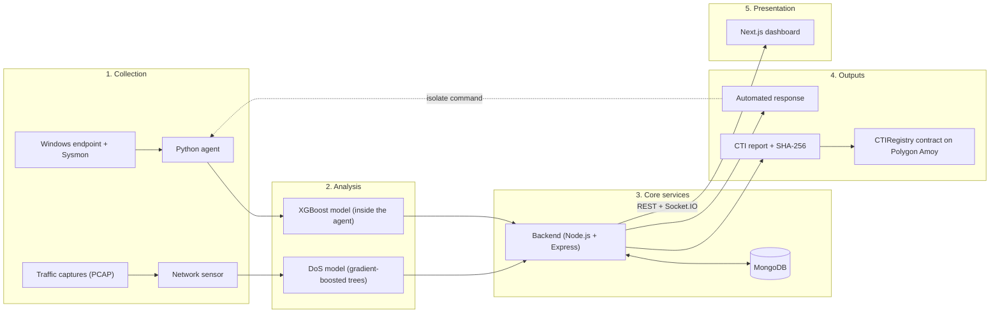
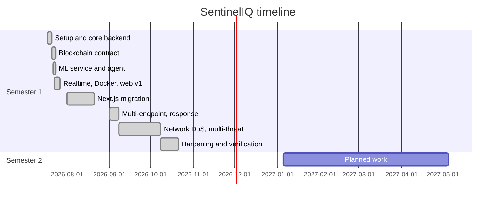
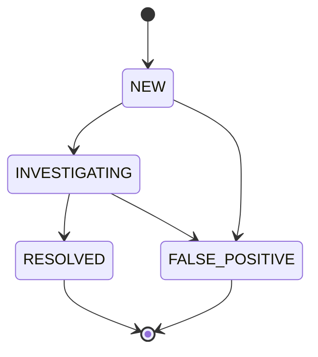

# SentinelIQ: ML-Based Attack Detection with Blockchain-Verified Threat Intelligence Sharing

---

## Table of Contents

1. Abstract
2. Introduction
3. Project Overview
4. Motivation
5. Problem Statement and Objectives
6. System Architecture
7. Methodology
8. Software and Hardware Requirements
9. Project Schedule
10. System Design
11. Implementation Details
12. Conclusion
13. Future Work
14. Plan for Next Semester

---

## 1. Abstract

The aim of this project is to build a platform that finds ransomware and denial-of-service (DoS/DDoS) attacks early using machine learning, and lets organisations share reports about these attacks in a form that nobody can secretly change. The platform is called **SentinelIQ**.

To reach this aim, a Python agent watches Windows computers through Microsoft Sysmon and turns their activity into 21 behaviour measurements every 10 seconds. An XGBoost model scores these measurements for ransomware. A separate network sensor scores network traffic for DoS and DDoS floods. A Node.js server collects every alert, links related alerts, and can automatically put an infected computer into isolation. When an analyst asks for it, the server writes a threat report about an incident and stores the report's fingerprint on the Polygon Amoy blockchain. Analysts use a web dashboard to manage all of this.

Most of the aim has been achieved. The ransomware model reached a ROC-AUC of 0.9956 and an F1-score of 0.9614. On a held-out test, the network model caught every SYN-flood attack and raised no false alerts. The full chain, from detection to dashboard to blockchain record, was shown working, and all 21 automated build and test steps passed. Two parts are not finished yet: testing on live company traffic, and detecting data theft (exfiltration).

---

## 2. Introduction

Cyber attacks are now a normal business risk, not a rare event. Two kinds of attack cause a lot of the damage:

- **Ransomware** locks a victim's files with encryption and asks for money to unlock them. A single attack can stop a hospital, a school or a factory for days.
- **Denial-of-service (DoS) and distributed denial-of-service (DDoS) attacks** flood a server or network with fake traffic until real users cannot reach it.

Traditional antivirus tools look for known "signatures", meaning fixed patterns of known malware. Attackers get around this by changing their code slightly, so the signature no longer matches. A newer approach is **behaviour-based detection**: instead of asking "have I seen this file before?", the system asks "is this program acting the way ransomware acts?" Machine learning suits this well because it can learn the difference between normal and harmful behaviour from examples.

A second idea in this field is **Cyber Threat Intelligence (CTI)**. When one organisation is attacked, the details it learns (which files, addresses and techniques the attacker used) can help other organisations defend themselves. For this sharing to work, the receiver must be able to trust that the report is real and has not been edited. **Blockchain** helps here: once a record is written to a public blockchain it cannot be changed, so it can act as a neutral, permanent proof of what a report originally said.

SentinelIQ brings these three ideas together: behaviour-based machine learning, threat intelligence sharing, and blockchain-based proof.

---

## 3. Project Overview

SentinelIQ is a multi-part security platform for a security team (often called a Security Operations Centre, or SOC). Each organisation that signs up gets its own private workspace.

| Part | Role in the product |
|---|---|
| Windows agent | Runs on each protected computer and reports suspicious behaviour |
| Network sensor | Examines network traffic captures for flooding attacks |
| ML service | Hosts the trained ransomware model behind a web API |
| Backend server | The central brain that stores data, applies rules and talks to the blockchain |
| Web dashboard | The screen analysts use every day |
| Smart contract | A small program on the blockchain that stores and checks report fingerprints |

**Main features available to a user:**

- A live dashboard with active alerts, their severity and the attack techniques seen
- A detection list with a detail page showing the evidence behind each alert
- An endpoint list where computers can be added, monitored and isolated
- Response policies that decide what happens automatically when an alert matches a rule
- A "cascade" view that groups attacks spreading across several computers
- A CTI draft editor, a CTI feed and a blockchain verification page
- Team management with roles, plus a full audit log of who did what

---

## 4. Motivation

Several practical observations led to this project:

1. **Speed matters more than anything in ransomware.** Ransomware can encrypt thousands of files within minutes. A tool that reports the attack an hour later is close to useless. We wanted detection fast enough to respond while the attack is still running.
2. **Small organisations cannot afford big security products.** Commercial endpoint detection tools are expensive. We wanted to show that a capable system can be built with free and open-source tools such as Sysmon, XGBoost, MongoDB and a public test blockchain.
3. **Organisations rarely share what they learn.** Companies fear that shared reports may be faked, altered or leaked. A tamper-proof record could remove one of these fears and encourage more sharing.
4. **Many academic models never leave the notebook.** Many research papers report high accuracy but never connect the model to a real computer, a real alert or a real response. We wanted a complete, working pipeline rather than a model in isolation.
5. **Learning value.** The project combines operating-system internals, machine learning, full-stack web development and blockchain. This gave the team practical experience across the whole security engineering stack.

---

## 5. Problem Statement and Objectives

### 5.1 Problem Statement

*Organisations need a low-cost way to detect ransomware and DoS/DDoS attacks while they are happening, respond to them quickly, and share trustworthy evidence of those attacks with other organisations. Current signature-based tools miss new attack variants, and current sharing methods give the receiver no way to prove that a threat report has not been altered.*

### 5.2 Objectives

| No. | Objective | Measured by |
|---|---|---|
| O1 | Detect ransomware from the behaviour of running programs, not from file signatures | Model ROC-AUC and F1-score on unseen data |
| O2 | Detect DoS/DDoS floods from network traffic | Recall and false-alert rate on held-out attacks |
| O3 | Reduce false alarms from short, harmless spikes in activity | Score smoothing and multi-step alert levels |
| O4 | Respond automatically to serious attacks | Policy engine able to isolate hosts and escalate alerts |
| O5 | Produce threat reports that can be proven unaltered | Report hash stored and verifiable on a blockchain |
| O6 | Give analysts one clear place to work | Working multi-page dashboard with live updates |
| O7 | Keep each organisation's data separate and access controlled | Login, roles and per-organisation data isolation |

### 5.3 Scope

**Covered:** Windows endpoints, ransomware, privilege escalation (rule-based, alert only), DoS/DDoS from recorded traffic, CTI reports for ransomware, and the Polygon Amoy test blockchain.

**Not covered yet:** Linux or macOS endpoints, verified live network capture (the code exists but has only been tested on recorded traffic), data-theft detection, real network containment, and a production (main-net) blockchain.

---

## 6. System Architecture

The system is arranged in five layers. Data moves from left to right, and each layer only talks to its direct neighbours.



| Layer | Responsibility | Talks to |
|---|---|---|
| Collection | Gathers raw activity from computers and networks | Analysis layer |
| Analysis | Turns raw activity into a risk score | Core services |
| Core services | Stores data, applies policies, links alerts, controls access | Outputs, Presentation, Database |
| Outputs | Takes action and publishes proof | Blockchain, Agent |
| Presentation | Shows everything to the analyst in real time | Core services |

**Key architectural choices:**

- **Detection at the edge.** The agent loads the XGBoost model and scores activity on the computer itself, so detection does not depend on a network round trip. A separate FastAPI ML service also exists for serving the model over an API, but the live agent does not use it.
- **Push-based live updates.** The dashboard receives new alerts through WebSockets (Socket.IO), so it does not need to keep asking the server for changes.
- **Only a fingerprint goes on-chain.** The full report stays in the database, and only its 32-byte hash is stored on the blockchain. This keeps costs low and keeps sensitive details private.
- **Containerised services.** The backend, ML service and database start together with Docker Compose. The agent runs directly on Windows because it needs real access to the operating system.

---

## 7. Methodology

This section explains *how* the detection models were built and judged. The software structure is covered separately in Sections 10 and 11.

### 7.1 Overall Approach

The work followed an iterative cycle: **collect data → engineer features → train → evaluate → connect to the live pipeline → test end to end → refine.** Each cycle added one complete working slice, rather than finishing one layer fully before starting the next.

### 7.2 Ransomware Detection Model

**Step 1: Data.** A labelled ransomware behaviour dataset (`RANSOMWARE.csv`) was used. Each row describes the activity of a process, labelled as ransomware or benign.

**Step 2: Feature design.** We chose 21 features that capture how ransomware differs from normal software. They fall into five groups:

| Group | Example features | Why it helps |
|---|---|---|
| Activity counts | processes created, files created, registry writes, DNS queries | Ransomware is unusually busy |
| Activity rates | file, process, network and registry activity per second | Captures sudden bursts |
| File spread | unique extensions written, unique folders touched | Ransomware touches many folders and file types |
| Encryption signs | known encrypted extensions, file-name entropy | Encrypted output looks random |
| Location signs | suspicious path ratio, average path length | Malware often works from temp or user folders |

**Step 3: Model training and selection.** Two algorithms were trained on the same split: **Random Forest** and **XGBoost**. The one with the higher ROC-AUC on held-out test data was kept automatically. XGBoost won.

**Step 4: Evaluation.**

| Metric | Result |
|---|---|
| ROC-AUC | 0.9956 |
| F1-score (ransomware class) | 0.9614 |

**Step 5: Reducing false alarms in live use.** A single high score can come from a harmless burst, such as a software update. So the live score is smoothed with an **Exponential Moving Average (EMA, α = 0.4)**, which gives more weight to recent readings without overreacting to one spike. The smoothed score is then compared with fixed levels: **≥ 0.50 = suspicious**, **≥ 0.65 = alert**, and three alerts in a row = **critical**.

### 7.3 DoS/DDoS Detection Model

**Data.** Real labelled traffic from the public **CIC-DDoS2019** dataset. Before training, the labels were checked against the dataset's published attack timings.

**Windowing.** Traffic is cut into 5-second windows for each destination address, and 47 measurements are computed for each window.

**Fair testing.** The data was split forward in time, so the model never "sees the future". One attack family, **SYN floods**, was kept fully outside training and used only once, for the final test.

**Results on the held-out SYN floods:**

| Metric | Result |
|---|---|
| Recall | 1.0 (95% confidence interval 0.959–1.0) |
| False-positive rate | 0.0 |
| False alerts | 0 in 49 hours of benign destination traffic |
| Detection delay | 10 seconds |

### 7.4 Privilege-Escalation Detection

Machine learning needs a lot of labelled data, and good public data for privilege escalation is scarce. So this detector is **rule-based**. It uses six rules (PE-01 to PE-06) that look for known signs, such as a low-privilege program starting a SYSTEM-level shell, UAC-bypass registry changes, or new admin accounts. Each alert carries a confidence tier: *suspicious*, *likely* or *confirmed*.

### 7.5 Mapping to MITRE ATT&CK

Each alert is linked to a technique in the MITRE ATT&CK catalogue, for example **T1486 Data Encrypted for Impact** for ransomware and **T1498 Network Denial of Service** for floods. The mapping is based on the evidence that actually triggered the alert, and the reason is stored with it.

---

## 8. Software and Hardware Requirements

### 8.1 Software Requirements

| Category | Software | Version used |
|---|---|---|
| Operating system (agent) | Microsoft Windows | 10 / 11 |
| System monitoring | Microsoft Sysmon | Latest, with project config file |
| Agent and ML language | Python | 3.11+ (network sensor uses 3.13) |
| ML libraries | XGBoost, scikit-learn, pandas, NumPy, joblib | XGBoost 2.x, scikit-learn 1.3+ |
| ML API | FastAPI, Uvicorn, Pydantic | FastAPI 0.110+ |
| Agent libraries | pywin32, psutil, requests | pywin32 306+ |
| Backend runtime | Node.js, TypeScript | Node 20+, TypeScript 5.x |
| Backend framework | Express, Mongoose, Socket.IO, jsonwebtoken, ethers | Express 4, Mongoose 8, Socket.IO 4, ethers 6 |
| Database | MongoDB | 7.x (local) / MongoDB Atlas |
| Frontend | Next.js, React, Tailwind CSS | Next 15, React 19, Tailwind 4 |
| Blockchain tools | Solidity, Hardhat, OpenZeppelin | Hardhat 3 (needs Node 22+) |
| Blockchain network | Polygon Amoy testnet | — |
| Wallet | MetaMask (funded with test POL) | — |
| Containers | Docker Desktop, Docker Compose | — |
| Version control | Git, GitHub (with CodeQL scanning) | — |

### 8.2 Hardware Requirements

| Item | Minimum | Recommended |
|---|---|---|
| Processor | 4-core x64 CPU | 6+ cores |
| Memory (RAM) | 8 GB | 16 GB (to run all services plus Docker at once) |
| Storage | 20 GB free | 50 GB+ SSD (traffic datasets are large) |
| Network | Internet access to reach the blockchain RPC and MongoDB Atlas | Stable broadband |
| Endpoint | Windows machine with administrator rights for Sysmon and the agent | A spare virtual machine for safe attack simulation |

---

## 9. Project Schedule

The work was planned in phases. The dates below follow the project's commit history.

| Phase | Period (2026) | Work done | Status |
|---|---|---|---|
| 1. Planning and setup | 18 – 19 Jul | Shared data types, backend skeleton, database connection | Done |
| 2. Core backend | 19 – 20 Jul | Login (JWT), organisations, endpoints, audit logging, detection API | Done |
| 3. Blockchain | 21 – 23 Jul | CTIRegistry contract, tests, access control, Amoy deployment | Done |
| 4. ML service | 22 Jul | Model training (RF vs XGBoost) and prediction API | Done |
| 5. Windows agent | 22 – 23 Jul | Agent skeleton, Sysmon integration, feature extraction | Done |
| 6. Real-time and deployment | 23 – 26 Jul | Team management, live notifications, Docker, first web app | Done |
| 7. Frontend upgrade | Aug | Move to Next.js App Router, improved agent ML pipeline | Done |
| 8. Multi-endpoint and response | 1 – 7 Sep | Many agents per organisation, isolation, policies, cascades, architecture document | Done |
| 9. Network DoS and multi-threat | Sep – Oct | Network sensor, DoS model, privilege-escalation rules, MITRE mapping | Done |
| 10. Hardening and verification | Oct | Removed placeholder UI, deduplication, full test suite, report | Done |
| 11. Next semester | Jan – May 2027 | See Section 14 | Planned |



---

## 10. System Design

This section describes the structure of the data, interfaces and components. It does not repeat the architecture layers from Section 6.

### 10.1 Database Design (MongoDB collections)

| Collection | Main fields | Purpose |
|---|---|---|
| organizations | name, settings | One tenant (company) |
| users | email, password hash, role, organisationId | People who log in |
| sessions | refresh token, expiry | Keeps users signed in safely |
| invitations | email, role, token | Adds team members |
| endpoints | hostname, status, activation token, last seen | Protected computers and sensors |
| detections | attackType, riskScore, severity, status, confidenceTier, mitre[], evidence, dataOrigin | Every alert raised |
| endpointActions | type (isolate / unisolate), status | Record of each response taken |
| policies | conditions, actions, enabled | Automatic response rules |
| cascades | linked detections, hosts, time span | Attacks spreading across machines |
| ctiReports | content, SHA-256 hash, tx hash, block number, status | Threat intelligence reports |
| timelineEvents | detectionId, event, time | Step-by-step history of an incident |
| auditLogs | user, action, target, time | Who did what, for accountability |

Every record that belongs to a tenant carries an `organizationId`, and every query filters on it. This keeps one company's data invisible to another.

### 10.2 Detection Lifecycle



### 10.3 CTI Report Lifecycle

`Draft` → analyst edits and approves → `Approved` (content frozen) → hash computed → `Published` on-chain → anyone can `Verify`. A corrected report is published as a new version that *supersedes* the old one, so history is never overwritten.

### 10.4 Smart Contract Design (`CTIRegistry.sol`)

| Function | Who can call | What it does |
|---|---|---|
| `publishCTI(reportKey, contentHash, …)` | Owner only (backend wallet) | Stores a report fingerprint and emits a `CTIPublished` event |
| `verifyCTI(reportKey, contentHash)` | Anyone (read only, free) | Returns true if the hash matches what was stored |
| `getCTI(reportKey)` | Anyone (read only, free) | Returns the stored record |

Access control uses OpenZeppelin's `Ownable`, so nobody except the platform can write records.

### 10.5 API Design (main route groups)

| Route group | Examples |
|---|---|
| `/api/auth` | register, login, refresh, logout, change password |
| `/api/endpoints` | add, list, get, remove, isolate |
| `/api/detections` | ingest, list, detail, resolve, timeline |
| `/api/policies` | create, edit, enable/disable |
| `/api/cti` | create draft, edit, approve, publish, verify, feed |
| `/api/users`, `/api/audit-logs` | team management, audit history |

### 10.6 Security Design

- Passwords are stored only as hashes. Login uses short-lived JWT access tokens plus refresh tokens.
- Role-based access control limits who can publish CTI, change policies or isolate machines.
- Each endpoint registers with a one-time activation token.
- Network DoS alerts can **never** isolate a computer or become CTI. This safety rule stops a noisy network signal from causing harm.
- Test and demonstration records are kept apart from real incidents and shown only in a clearly labelled view.

---

## 11. Implementation Details

This section explains how the main parts were actually coded.

### 11.1 Repository Layout

```
SentinelIQ/
├── agent/                 Windows agent (Python)
├── sensor/netsensor/      Network traffic sensor and DoS model (Python)
├── apps/ml-service/       FastAPI model server
├── apps/backend/          Express + TypeScript API
├── apps/web/              Next.js dashboard
├── blockchain/            Solidity contract + Hardhat tests
├── packages/shared-types/ Types shared by backend and web
└── scripts/               Demo, replay and release-check tools
```

### 11.2 Windows Agent

- `sysmon_reader.py` reads new Sysmon events from the Windows event log about every 3 seconds.
- `sliding_window_buffer.py` keeps each process's events from the last 10 seconds.
- `feature_extractor.py` computes the 21 features. File-name randomness is measured with **Shannon entropy**.
- `agent.py` scores the feature vector with the local XGBoost model (`models/ransomware_xgb.json`) and applies EMA smoothing to the result.
- `privilege_escalation.py` runs the six rules on the same event stream.
- `mitre_mapper.py` attaches technique IDs to each alert.
- `isolation_provider.py` carries out isolation commands from the backend. For safety, isolation is currently non-destructive: the agent enters an ISOLATED state and stops reporting, but it does not change firewall rules or end processes.

### 11.3 Network Sensor

- `pcap_reader.py` and `packet.py` read raw capture files using only the Python standard library.
- `flows.py` and `windows.py` group packets into 5-second windows for each destination.
- `pipeline.py` and `ml/` score each window. Windows above the threshold are merged into a single **alert episode** per attack, so one long flood does not create hundreds of alerts.
- `ingest.py` signs in and forwards the episodes to the backend.

### 11.4 Backend

- **Detection service:** saves alerts and attaches MITRE techniques. It **deduplicates** each episode using a key built from endpoint, origin, type, rule, model, time and target. Sending the same alert again returns the stored record instead of creating a copy.
- **Cascade service:** links detections from different computers that happen within **120 seconds** of each other into one cascade.
- **Policy service:** checks each new detection against the organisation's rules on a 0–100 risk scale and triggers the chosen response.
- **CTI and anchor services:** build the report and convert it to a fixed (canonical) text form, so the same report always gives the same hash. They then compute **SHA-256** and call the contract through `ethers.js`.
- **Socket.IO:** pushes new detections, resolutions and CTI publications to the dashboard instantly.

### 11.5 Web Dashboard

The dashboard is built with Next.js 15 (App Router), React 19 and Tailwind CSS 4. It has 17 pages, including the dashboard, detections, endpoints, cascades, policies, CTI centre, CTI draft editor, CTI feed, blockchain verification, threat intel, team, audit logs and settings. The verification page asks the backend to recompute the report's hash and compare it with the value stored on the blockchain.

### 11.6 Testing

A single command, `npm run release:check`, builds every part and runs every test suite against a temporary database. It never touches the real database and never sends a blockchain transaction.

| Test area | Result |
|---|---|
| Builds and type checks (shared types, backend, web) | Pass |
| Web unit tests | 28 / 28 |
| Web production build | Pass |
| Backend unit tests and local-blockchain tests | Pass |
| Backend database test suites | 10 / 10 suites |
| Network sensor tests | 136 pass |
| Agent tests | 39 pass |
| **Total steps** | **21 / 21 pass** |

A browser check of the real running app also passed 26 checks across all main pages.

---

## 12. Conclusion

This semester's work shows that a small team can build a working security platform that connects machine learning detection, automatic response and tamper-proof threat sharing, using only free and open-source tools and a public test blockchain.

Measured against the objectives in Section 5.2:

| Objective | Outcome |
|---|---|
| O1 Ransomware detection | **Met:** ROC-AUC 0.9956, F1 0.9614 |
| O2 DoS/DDoS detection | **Met on test data:** recall 1.0, no false alerts on the held-out SYN floods |
| O3 Fewer false alarms | **Met:** EMA smoothing, tiered alert levels and episode grouping |
| O4 Automatic response | **Mostly met:** policies can isolate hosts and escalate alerts, with safety limits; isolation does not yet cut network access |
| O5 Verifiable reports | **Met:** hashes anchored on Polygon Amoy and checked from the dashboard |
| O6 Analyst dashboard | **Met:** 17 pages with live updates |
| O7 Tenant isolation and access control | **Met:** per-organisation data, roles and audit log |

**Honest limitations:**

- The DoS model was trained and tested on a single capture setup, so it may behave differently on other networks.
- The live Windows pipeline was built and unit-tested, but has not yet been run against a real ransomware sample on a monitored machine.
- No external indicator feed is connected yet, so threat-intel matching has no live data to compare against.
- The blockchain is a free test network, not a production network.

---

## 13. Future Work

These are long-term directions beyond the next semester:

- **More operating systems:** agents for Linux (using auditd or eBPF) and macOS.
- **Federated learning:** organisations improve a shared model together without sending their raw data to anyone.
- **Standard sharing formats:** export reports in STIX/TAXII so other security tools can read them directly.
- **Production blockchain:** move to a main network or a permissioned consortium chain shared by partner organisations.
- **Explainable AI:** show analysts *which* features caused each alert, for example using SHAP values.
- **Adversarial robustness:** test whether attackers can fool the model by slowing down or disguising their behaviour.
- **Commercial readiness:** single sign-on, high availability and formal security certification.

---

## 14. Plan for Next Semester

These are concrete items planned for the next semester (January – May 2027), in order of priority:

| No. | Planned addition | What it will deliver |
|---|---|---|
| 1 | **Data exfiltration detection** | Rules that spot large uploads, archiving followed by upload, use of transfer tools (rclone, curl, scp) and DNS tunnelling, with links to related ransomware alerts ("double extortion") |
| 2 | **Live ransomware validation** | Run real, safe ransomware samples inside an isolated virtual machine with Sysmon installed, and measure detection time and accuracy on live activity |
| 3 | **Live network sensing** | Move the network sensor from recorded files to live traffic capture, and test the DoS model on a second dataset to check that it works on other networks |
| 4 | **Threat intelligence feed** | Connect a real indicator feed, such as malicious IPs, domains and file hashes, so detections are matched against known threats |
| 5 | **CTI for all attack types** | Extend report creation and blockchain anchoring to privilege escalation and exfiltration, not only ransomware |
| 6 | **Cross-organisation sharing** | Let one organisation receive, view and verify reports published by another, with sharing controls |
| 7 | **Better telemetry** | Add Windows ETW sources to measure bytes sent and file reads for each process, which Sysmon alone cannot provide |
| 8 | **Model explanations in the UI** | Show the top features behind each ML alert on the detection page |
| 9 | **Final evaluation and report** | Full performance testing, a user study with analysts, and the final project report |

**Planned timeline:**

| Month (2027) | Focus |
|---|---|
| January | Better telemetry (ETW) and design of exfiltration rules |
| February | Exfiltration detection and threat intelligence feed |
| March | Live ransomware and live network testing in a lab |
| April | CTI for all attack types, cross-organisation sharing, model explanations |
| May | Final evaluation, documentation and presentation |
