# Chapter 3 (continued): System Design

> **Source of truth.** Every diagram in this chapter was drawn from the SentinelIQ source code
> (`agent/`, `sensor/netsensor/`, `apps/backend/src/`, `apps/web/src/`, `blockchain/contracts/`),
> not from the planning documents. Where the code and earlier descriptions differ, the code was
> followed and the difference is stated under **Assumptions and limitations**.
>
> **Rendering.** Every diagram is a self-contained Mermaid block. Paste the code between the
> fences into <https://mermaid.live/>, then export it with *Actions → PNG / SVG*.

---

## 3.1 System Design Overview

The system design of SentinelIQ follows a producer–core–consumer pattern:

- **Producers.** The Windows endpoint agent (`agent/`) and the network sensor (`sensor/netsensor/`) observe activity, run their own detection models locally and submit structured detections.
- **Core.** The Node.js/Express backend (`apps/backend/`) is the only component that writes to the database. It validates and deduplicates incoming detections, correlates them, applies response policies, manages CTI reports and is the only party that signs blockchain transactions.
- **Consumers.** The Next.js web application (`apps/web/`) reads through the REST API and receives push updates through Socket.IO. The Windows agent also consumes isolation commands, which it collects in its heartbeat response.

Four design decisions shape the diagrams that follow:

1. **Inference happens at the edge.** The agent loads its XGBoost model from `agent/models/ransomware_xgb.json`. The network sensor loads a trained model bundle from disk. Neither calls a remote service per window.
2. **Detection type controls behaviour.** A per-type *response profile* (`services/detectionProfile.ts`) decides whether a detection can mark an endpoint *at risk*, join cascade correlation, run policies, isolate a host or produce a CTI draft.
3. **Reports live off-chain, fingerprints live on-chain.** The full CTI report and its canonical JSON are stored in MongoDB. Only a 32-byte SHA-256 digest, keyed by `keccak256(reportId)`, is written to the `CTIRegistry` contract on Polygon Amoy (chain ID 80002).
4. **Tenant isolation everywhere.** Every tenant-owned collection carries an `organizationId`, and every service query filters on it.

---

## 3.2 Data Flow Diagrams

### Fig. 3.3 Level 0 DFD (Context Diagram)

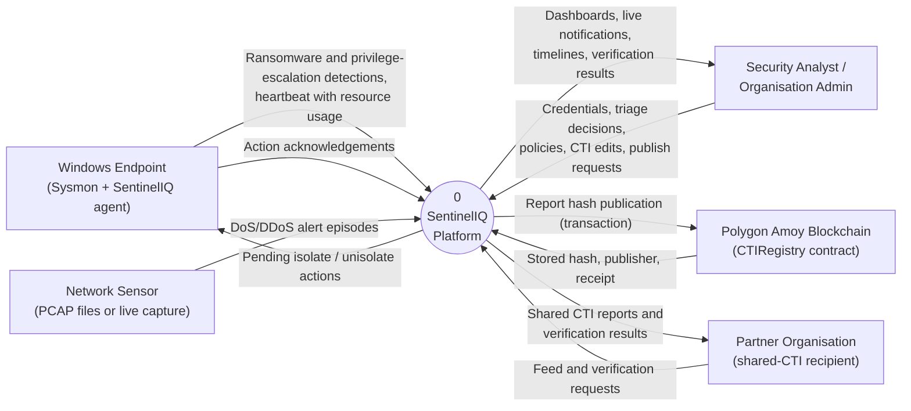

**Explanation.** The context diagram treats SentinelIQ as a single process (Process 0) and shows the five external entities it exchanges data with. The Windows endpoint and the network sensor are the sources of detection data. The endpoint is also the destination for containment commands, which it collects through its heartbeat. Human users submit configuration and triage decisions and receive dashboards and notifications. The Polygon Amoy network receives report fingerprints and returns the stored records used for verification. A partner organisation is another SentinelIQ tenant that receives reports shared with it and can verify them independently.

**Assumptions and limitations.**
- The Windows agent and the network sensor are deployed *outside* the backend and authenticate with a service API key (`x-api-key`). They are therefore modelled as external entities, even though they belong to the SentinelIQ codebase.
- "Partner organisation" means another tenant on the same SentinelIQ deployment (`visibility = SHARED_SELECTED | SHARED_ALL`). No cross-deployment federation exists.
- The live-capture path of the network sensor (`netsensor live`) is implemented and unit-tested, but the verified demonstration used recorded PCAP files (`dataOrigin = PCAP_REPLAY`).

---

### Fig. 3.4 Level 1 DFD

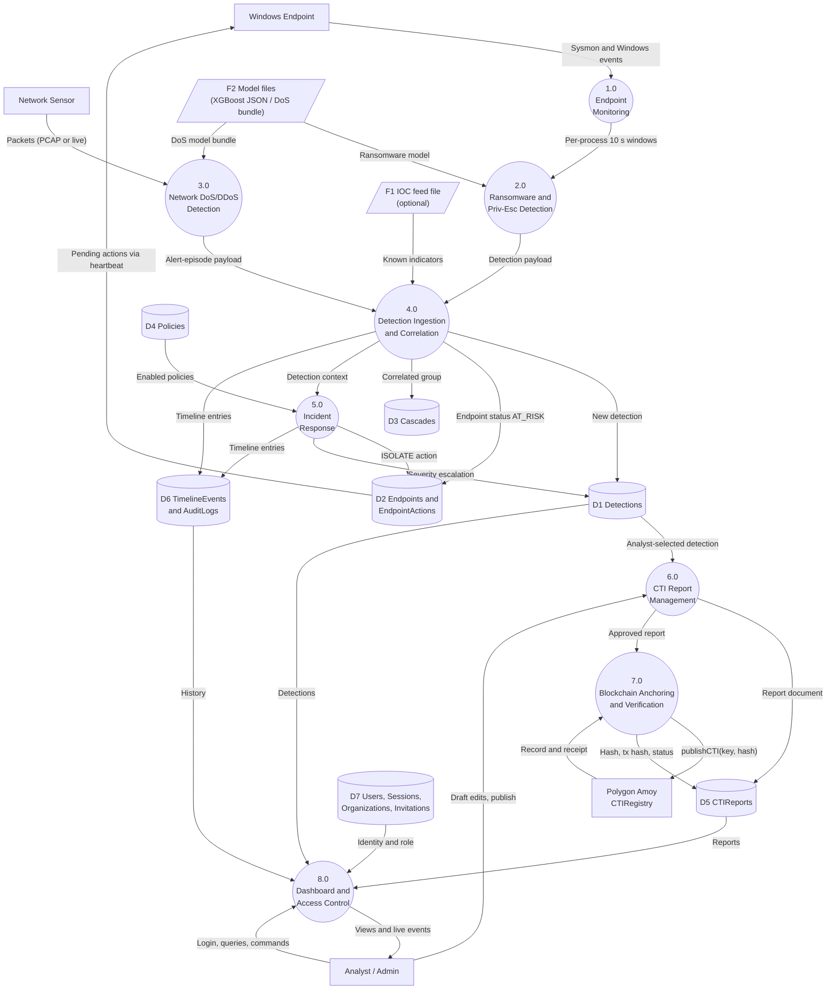

**Explanation.** The Level 1 DFD splits SentinelIQ into eight processes:

- **Processes 1.0–3.0** run outside the backend. The agent collects Windows events into per-process windows and scores them, and the network sensor scores five-second traffic windows.
- **Process 4.0** is the single entry point for all detections (`POST /api/detections/ingest`). It deduplicates sensor episodes, checks indicators against the optional IOC feed, assigns MITRE ATT&CK techniques, stores the detection, updates the endpoint status and correlates detections into cascades.
- **Process 5.0** evaluates enabled response policies. It may queue an isolation action or escalate the detection's severity.
- **Processes 6.0 and 7.0** turn an analyst-selected detection into a CTI report, anchor its fingerprint on Polygon Amoy and later verify it.
- **Process 8.0** authenticates users and serves every view.

Nine data stores are shown. D1–D7 are MongoDB collections, F1 is an optional JSON indicator file, and F2 is a set of model files on disk.

**Assumptions and limitations.**
- **CTI generation is analyst-initiated.** A draft is created by `POST /api/cti` for a detection the analyst selects. It is not produced automatically when a detection arrives. The `Organization.ctiSharingMode` field (`AUTO | MANUAL`) exists in the schema but is not read by any service.
- **The IOC feed is optional.** F1 is read only when the environment variable `THREAT_INTEL_IOC_FILE` is set. In the verified deployment it was not set, so IOC matching did not fire.
- **The ML service is not on the live path.** The FastAPI ML service (`apps/ml-service`, `POST /predict/`) is a separate, containerised model-serving API. The running agent does not call it, so it is omitted from this DFD.

---

## 3.3 UML Diagrams

> **Notation limitation.** Mermaid has native support for sequence diagrams only. It has no
> dedicated UML use-case, component or deployment diagram types. Those three are therefore drawn
> with Mermaid `flowchart` syntax, using the shape conventions listed under each figure.

### Fig. 3.5 Use Case Diagram

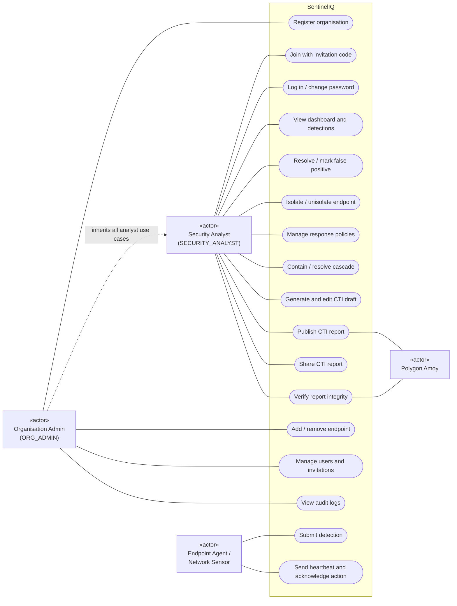

**Explanation.** The diagram identifies four actors:

- **Security Analyst.** Monitors detections, triages and resolves them, isolates endpoints, maintains response policies, contains cascades and handles the full CTI lifecycle.
- **Organisation Admin.** Has every analyst capability, shown by the generalisation arrow. In addition, the admin registers the organisation, manages endpoints and team members, and reads the audit log.
- **Endpoint Agent / Network Sensor.** Machine actors that submit detections, send heartbeats and acknowledge containment commands.
- **Polygon Amoy.** A secondary actor that takes part in publishing and verifying reports.

**Assumptions and limitations.**
- Role checks follow the backend routes: `requireRole("ORG_ADMIN")` for endpoints, users, invitations and audit logs, and `requireRole("ORG_ADMIN","SECURITY_ANALYST")` for resolve, isolate, policy, cascade and share actions. CTI draft, publish and verify require only an authenticated user.
- A third role, `SUPER_ADMIN`, is defined in the `User` schema but has no route or function of its own, so it is not shown.
- The dashed arrow stands in for UML generalisation (a hollow-triangle arrowhead), which Mermaid flowcharts cannot draw.

---

### Fig. 3.6 Component Diagram

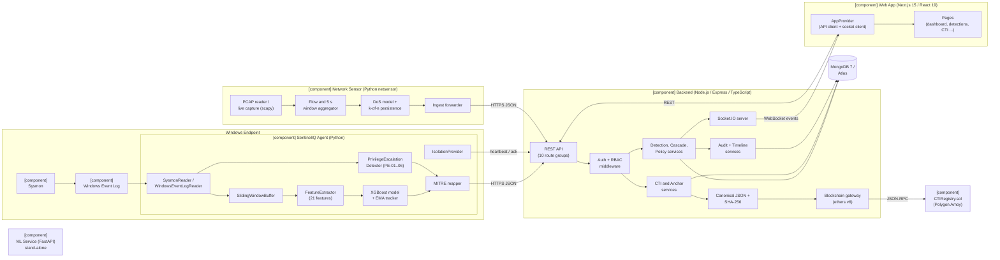

**Explanation.** The component diagram shows the five deployable software components and their internal parts:

- **Agent.** Reads Sysmon and Windows event logs, buffers events per process, extracts 21 features, scores them with a locally loaded XGBoost model smoothed by an EMA tracker, runs six privilege-escalation rules, attaches MITRE techniques and carries out containment commands.
- **Network sensor.** Builds five-second destination windows, scores them with a gradient-boosted DoS model, groups alerts into episodes using a k-of-n persistence rule (k = 2, n = 3) and forwards them.
- **Backend.** Exposes ten REST route groups behind authentication and role-based middleware, and coordinates the detection, cascade, policy, CTI, anchoring, audit and timeline services. It is the only component connected to MongoDB and to the blockchain.
- **Web application.** Consumes the REST API and the Socket.IO event stream through a single `AppProvider`.

**Assumptions and limitations.**
- Components are drawn as labelled boxes, because Mermaid has no UML component notation (component icon, provided/required interface lollipops).
- The FastAPI ML service is shown without connections because nothing in the live detection path calls it. The agent's `ml_client.py` contains a client for it, but the agent does not import that client.

---

### Fig. 3.7 Sequence Diagram: Ransomware Detection Workflow

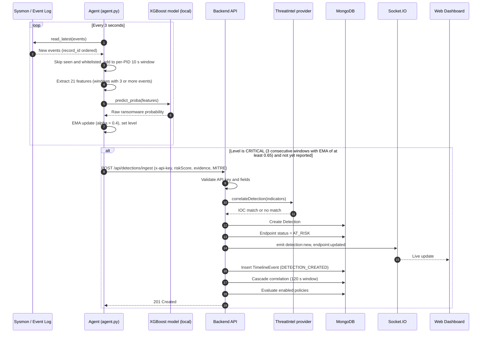

**Explanation.** The sequence diagram follows one ransomware alert from raw telemetry to the analyst's screen. Every three seconds, the agent reads new Sysmon events, adds them to ten-second per-process windows, extracts the feature vector and obtains a probability from the local XGBoost model. Exponential smoothing (α = 0.4) dampens single-window spikes. A detection is reported only when the smoothed score stays at or above 0.65 for three consecutive windows (the CRITICAL level), and only once per process. The backend validates the request, enriches it with IOC correlation, stores it, marks the endpoint at risk, pushes it to the dashboard over Socket.IO, records a timeline entry, and finally runs cascade correlation and policy evaluation.

**Assumptions and limitations.**
- The model runs inside the agent process. There is no network call to the ML service.
- Duplicate suppression for agent alerts happens on the agent side (one report per process). The backend's `sourceAlertKey` check applies only to payloads that carry both `ruleId` and `detectedAt`, which the network sensor sends and the agent does not.
- The agent sends `riskScore` on a 0–100 scale, and the backend derives severity from it: ≥ 90 CRITICAL, ≥ 70 HIGH, ≥ 40 MEDIUM, otherwise LOW.
- Live Sysmon operation is implemented, but in the verified submission it was exercised only through the agent's simulated telemetry provider and unit tests, because Sysmon was not installed on the verification machine.

---

### Fig. 3.8 Deployment Diagram

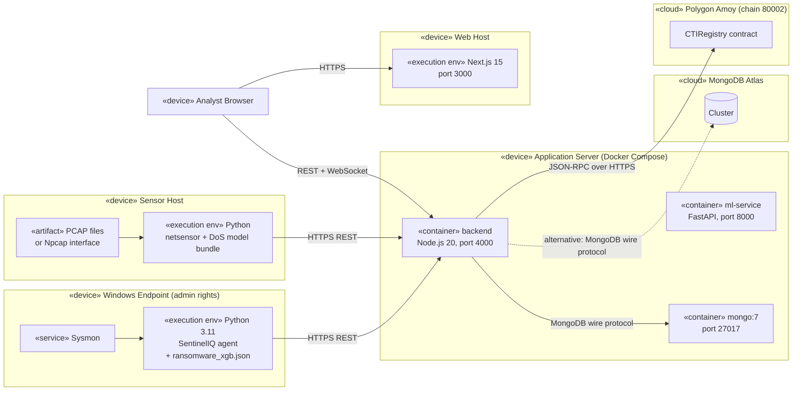

**Explanation.** The deployment diagram shows six nodes:

- **Windows endpoint.** Runs Sysmon and the Python agent with its bundled model, and needs administrator rights to read the Sysmon channel.
- **Sensor host.** Runs the Python network sensor against recorded PCAP files or, through Npcap, a live interface.
- **Application server.** Docker Compose starts three containers: the backend on port 4000, the ML service on port 8000 and MongoDB 7 on port 27017.
- **Web host.** Serves the Next.js application on port 3000.
- **MongoDB Atlas.** A hosted database that can replace the local MongoDB container.
- **Polygon Amoy.** The public test blockchain that hosts the `CTIRegistry` contract.

The analyst's browser loads the web application, then talks directly to the backend for REST calls and the Socket.IO stream.

**Assumptions and limitations.**
- Local MongoDB and Atlas are alternatives chosen through `MONGODB_URI`, not used together. The verified real run used Atlas, while automated tests use a disposable local `mongod`.
- In development, all server-side nodes usually run on a single machine. They are drawn separately to show logical deployment boundaries.
- UML node and artifact symbols (3-D boxes) are not available in Mermaid, so stereotypes in «guillemets» are used instead.

---

## 3.4 Database Design

### 3.4.1 Database Architecture

SentinelIQ uses **MongoDB**, a document database, accessed through the **Mongoose 8** object-document mapper. It is not a relational database:

- **Primary identifier.** Each document has an automatically generated `_id` of type `ObjectId`.
- **Document references.** Relationships are stored as `ObjectId` fields declared with `ref: "<Model>"`. These are *document references*, which Mongoose can resolve with `populate()`. MongoDB does **not** enforce them as foreign keys: there is no referential-integrity constraint and no cascading delete. Integrity is maintained by the service layer.
- **Embedded documents.** Some data is stored inside the parent document instead of in a separate collection, for example detection indicators, policy conditions and actions, and the CTI match result.
- **Denormalised copies.** Some values are copied for fast reading, such as `endpointName` on detections and timeline events, and `affectedEndpointNames` on cascades.
- **Timestamps.** Most schemas use `{ timestamps: true }`, which adds `createdAt` and `updatedAt` automatically.

### 3.4.2 Collections

**Table 3.1 MongoDB collections**

| No. | Collection (Mongoose model) | Purpose |
|---|---|---|
| 1 | `organizations` (Organization) | One tenant (customer organisation) |
| 2 | `users` (User) | Login identities with roles |
| 3 | `sessions` (Session) | Hashed refresh tokens, auto-expiring |
| 4 | `invitations` (Invitation) | One-time codes for joining an organisation |
| 5 | `endpoints` (Endpoint) | Monitored computers and network sensors |
| 6 | `endpointactions` (EndpointAction) | Isolate / unisolate commands and their delivery status |
| 7 | `detections` (Detection) | Every alert raised by an agent or sensor |
| 8 | `cascades` (Cascade) | Groups of related detections across endpoints |
| 9 | `policies` (Policy) | Automated response rules |
| 10 | `ctireports` (CTIReport) | Full threat-intelligence reports and anchoring state |
| 11 | `timelineevents` (TimelineEvent) | Forensic history of each endpoint and detection |
| 12 | `auditlogs` (AuditLog) | Record of user API actions |

### 3.4.3 Collection Schemas

Notation: **PK** = primary identifier, **Ref → X** = document reference to collection X, **[ ]** = array, **Emb** = embedded sub-document. All tenant-owned collections also carry `createdAt` and `updatedAt` unless stated otherwise.

**Table 3.2 `organizations`**

| Field | Type | Notes |
|---|---|---|
| `_id` | ObjectId | PK |
| `name` | String | Required |
| `ctiSharingMode` | String | `AUTO` or `MANUAL` (default `MANUAL`); stored but not yet used by any service |
| `retentionDays` | Number | Default 365 |

**Table 3.3 `users`**

| Field | Type | Notes |
|---|---|---|
| `_id` | ObjectId | PK |
| `organizationId` | ObjectId | Ref → organizations, required, indexed |
| `name` | String | Required |
| `email` | String | Required, **unique**, lower-case |
| `passwordHash` | String | Required, excluded from queries by default (`select: false`) |
| `role` | String | `ORG_ADMIN`, `SECURITY_ANALYST` (default) or `SUPER_ADMIN` |
| `isActive` | Boolean | Default true |
| `lastLoginAt` | Date | |
| `twoFactorEnabled` | Boolean | Default false |

**Table 3.4 `sessions`**

| Field | Type | Notes |
|---|---|---|
| `_id` | ObjectId | PK |
| `userId` | ObjectId | Ref → users, required |
| `refreshTokenHash` | String | Required |
| `expiresAt` | Date | TTL index: MongoDB deletes the document at this time |
| `createdAt` | Date | |

**Table 3.5 `invitations`**

| Field | Type | Notes |
|---|---|---|
| `_id` | ObjectId | PK |
| `code` | String | Required, **unique**, upper-case |
| `organizationId` | ObjectId | Ref → organizations |
| `createdBy` | ObjectId | Ref → users |
| `isConsumed` | Boolean | Default false |
| `consumedBy` | ObjectId | Ref → users |
| `consumedAt` | Date | |

**Table 3.6 `endpoints`**

| Field | Type | Notes |
|---|---|---|
| `_id` | ObjectId | PK |
| `organizationId` | ObjectId | Ref → organizations |
| `name` | String | Unique within an organisation among non-deleted endpoints (partial unique index) |
| `status` | String | `PENDING`, `ONLINE`, `OFFLINE`, `AT_RISK` or `ISOLATED` |
| `osVersion`, `agentVersion` | String | |
| `activationTokenHash` | String | Hidden by default |
| `activationTokenExpiresAt`, `activatedAt`, `lastCheckInAt` | Date | |
| `cpuUsagePercent`, `ramUsagePercent`, `diskUsagePercent` | Number | 0–100, from heartbeat |
| `isDeleted` | Boolean | Soft delete flag |

**Table 3.7 `endpointactions`**

| Field | Type | Notes |
|---|---|---|
| `_id` | ObjectId | PK |
| `organizationId` | ObjectId | Ref → organizations |
| `endpointId` | ObjectId | Ref → endpoints |
| `actionType` | String | `ISOLATE` or `UNISOLATE` |
| `status` | String | `PENDING`, `SENT`, `ACKNOWLEDGED`, `COMPLETED` or `FAILED` |
| `reason` | String | |
| `requestedByUserId` | ObjectId | Ref → users (empty when a policy triggered it) |
| `requestedAt`, `executedAt` | Date | |
| `errorMessage` | String | |

**Table 3.8 `detections`**

| Field | Type | Notes |
|---|---|---|
| `_id` | ObjectId | PK |
| `organizationId` | ObjectId | Ref → organizations |
| `endpointId` | ObjectId | Ref → endpoints |
| `endpointName` | String | Denormalised copy |
| `attackType` | String | e.g. `RANSOMWARE` (default), `PRIVILEGE_ESCALATION`, `DOS_DDOS` |
| `ruleId` | String | e.g. `PE-02`, `DOS-XGB` |
| `confidenceTier` | String | `suspicious`, `likely` or `confirmed` |
| `riskScore` | Number | 0–100, required |
| `severity` | String | Derived from `riskScore` |
| `status` | String | `NEW`, `INVESTIGATING`, `RESOLVED` or `FALSE_POSITIVE` |
| `indicators` | Emb [ ] | `{type, description, observedAt}` |
| `evidence` | Mixed [ ] | `{id, source, eventId, time, description, fields}` |
| `mitre` | Mixed [ ] | `{tacticId, tacticName, techniqueId, techniqueName, attackVersion, referenceUrl, evidenceRef, mappingReason}` |
| `ctiMatch` | Emb | `{matched, indicator, type, isMalicious, confidence, severity, threatCategory, tags, source, matchedAt}` |
| `modelVersion` | String | |
| `detectedAt`, `resolvedAt` | Date | |
| `resolvedByUserId` | ObjectId | Ref → users |
| `cascadeId` | String | Holds the cascade's business key (`cascades.cascadeId`), not an ObjectId |
| `dataOrigin` | String | `LIVE`, `PCAP_REPLAY`, `SIMULATED` or `DEMO` |
| `sourceAlertKey` | String | SHA-256 deduplication key for sensor episodes |
| `detectorStatus` | String | `TRAINED` or `HEURISTIC` |

**Table 3.9 `cascades`**

| Field | Type | Notes |
|---|---|---|
| `_id` | ObjectId | PK |
| `organizationId` | ObjectId | Ref → organizations |
| `cascadeId` | String | Business key, unique per organisation |
| `title`, `correlationReason` | String | |
| `attackType` | String | `RANSOMWARE_PROPAGATION`, `COORDINATED_C2_BURST`, `LATERAL_MOVEMENT` or `MULTI_HOST_ANOMALY` |
| `severity` | String | LOW–CRITICAL |
| `confidence` | Number | 0–100 |
| `status` | String | `ACTIVE`, `CONTAINED` or `RESOLVED` |
| `affectedEndpointIds` | ObjectId [ ] | Ref → endpoints |
| `affectedEndpointNames` | String [ ] | Denormalised |
| `relatedDetectionIds` | ObjectId [ ] | Ref → detections |
| `matchedIOCs` | String [ ] | |
| `firstSeen`, `lastSeen`, `containedAt`, `resolvedAt` | Date | |

**Table 3.10 `policies`**

| Field | Type | Notes |
|---|---|---|
| `_id` | ObjectId | PK |
| `organizationId` | ObjectId | Ref → organizations |
| `name`, `description` | String | |
| `enabled` | Boolean | Default true |
| `priority` | Number | Default 10; higher priority is evaluated first |
| `logicalOperator` | String | `AND` or `OR` |
| `conditions` | Emb [ ] | `{field, operator, value}`. `field` is one of `riskScore`, `severity`, `detectionType`, `consecutiveDetections`, `ctiMatch`, `ctiConfidence`, `maliciousIocMatch`, `affectedEndpointCount`, `crossEndpointAttack`, `endpointStatus` |
| `actions` | Emb [ ] | `{type, params}`. `type` is one of `ISOLATE_ENDPOINT`, `CREATE_ALERT`, `MARK_HIGH_RISK` |
| `cooldownPeriodSeconds` | Number | Default 300 |
| `lastTriggeredAt` | Date | |
| `triggerCount` | Number | |
| `createdByUserId`, `updatedByUserId` | ObjectId | Ref → users |

**Table 3.11 `ctireports`**

| Field | Type | Notes |
|---|---|---|
| `_id` | ObjectId | PK |
| `reportId` | String | Human-readable report ID; its keccak256 is the on-chain key |
| `organizationId` | ObjectId | Ref → organizations (author tenant) |
| `detectionId` | ObjectId | Ref → detections, required |
| `createdByUserId` | ObjectId | Ref → users, required |
| `schemaVersion`, `attackType`, `title` | String | |
| `detectedAt` | Date | |
| `severity`, `riskScore`, `confidenceTier` | String / Number / String | |
| `attackSummary` | String | Required |
| `indicatorsOfCompromise`, `recommendedActions` | String [ ] | |
| `analystNotes` | String | |
| `detector` | Emb | `{type: rule or xgboost, id, version}` |
| `evidence`, `mitre` | Mixed [ ] | Copied from the detection |
| `hostRef`, `dataOrigin` | String | |
| `version` | Number | Revision number |
| `supersedes` | String | `reportId` of the revision it replaces |
| `visibility` | String | `PRIVATE`, `SHARED_SELECTED` or `SHARED_ALL` |
| `sharedWithOrgIds` | ObjectId [ ] | Ref → organizations (recipients) |
| `status` | String | `DRAFT`, `PENDING_APPROVAL`, `PUBLISHING`, `PUBLISHED`, `ANCHORED` or `FAILED` |
| `canonicalJson` | String | RFC 8785-style canonical text that was hashed |
| `contentHash` | String | SHA-256 hex digest |
| `anchorKey` | String | `keccak256(reportId)` |
| `transactionHash`, `blockNumber`, `publisherAddress`, `contractAddress`, `chainId`, `network` | Mixed | On-chain receipt details |
| `verificationStatus` | String | `VERIFIED`, `PENDING`, `FAILED`, `TAMPERED`, `UNANCHORED` or `UNTRUSTED_PUBLISHER` |
| `lastVerifiedAt`, `publishedAt`, `publishLockedUntil` | Date | |
| `anchorError` | String | |
| `failedTransactionHashes` | String [ ] | |
| `invalidatedAnchor` | Mixed | |

**Table 3.12 `timelineevents`**

| Field | Type | Notes |
|---|---|---|
| `_id` | ObjectId | PK |
| `organizationId` | ObjectId | Ref → organizations |
| `endpointId` | ObjectId | Ref → endpoints, required |
| `endpointName` | String | Denormalised |
| `detectionId` | ObjectId | Ref → detections (optional) |
| `actionId` | ObjectId | Ref → endpointactions (optional) |
| `eventType` | String | 19 values, e.g. `DETECTION_CREATED`, `ISOLATION_COMPLETED`, `POLICY_TRIGGERED`, `CTI_MATCHED`, `CASCADE_DETECTED` |
| `actorType` | String | `USER`, `SECURITY_ANALYST`, `ORG_ADMIN`, `AGENT`, `SYSTEM` or `AUTOMATED_POLICY` |
| `actorId` | ObjectId | |
| `actorName`, `message` | String | |
| `metadata` | Mixed | |
| `timestamp` | Date | |

**Table 3.13 `auditlogs`**

| Field | Type | Notes |
|---|---|---|
| `_id` | ObjectId | PK |
| `organizationId` | ObjectId | Ref → organizations |
| `userId` | ObjectId | Ref → users |
| `userEmail` | String | |
| `action` | String | e.g. `USER_LOGIN`, `CTI_PUBLISHED`, `ENDPOINT_ISOLATED` |
| `method`, `path` | String | HTTP method and route |
| `statusCode` | Number | |
| `success` | Boolean | |
| `ipAddress` | String | |
| `metadata` | Mixed | |
| `createdAt` | Date | TTL index: deleted after 365 days |

### Fig. 3.9 Entity-Relationship (Document Reference) Diagram

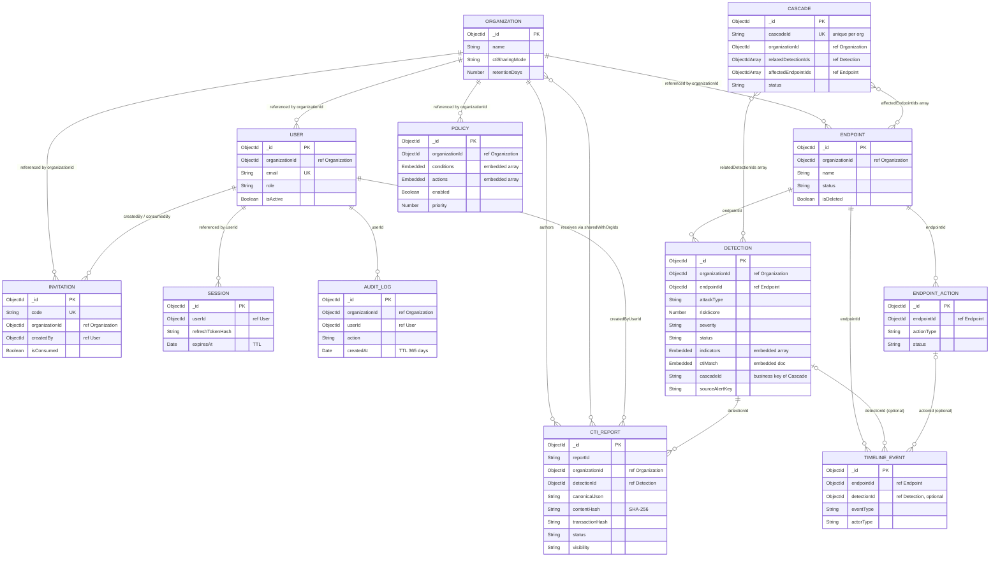

**Explanation.** The diagram shows the twelve collections and the document references between them. **Organization** is the root of the tenant hierarchy: users, endpoints, policies, invitations, CTI reports and audit logs all reference it. Each **endpoint** produces many **detections**, receives many **endpoint actions** and accumulates **timeline events**. A **detection** can be the source of one or more **CTI reports**: a report can be revised, and each revision is a new document that *supersedes* the previous one. A **cascade** groups several detections and endpoints through arrays of references. A detection points back to its cascade with the string business key `cascadeId`, not with an ObjectId. CTI reports have two links to organisations: one *author* reference (`organizationId`) and a *many-to-many* recipient list (`sharedWithOrgIds`).

**Assumptions and limitations.**
- Crow's-foot notation is used to show cardinality only. The relationships are **document references** (`ObjectId` + `ref`), not relational foreign keys, and MongoDB does not enforce them. The attribute comment `"ref X"` marks a reference field. Embedded sub-documents are marked with the `Embedded` type instead of being drawn as separate entities.
- Only the key attributes of each collection are shown, to keep the diagram readable. Tables 3.2–3.13 list every field.
- "Incident" is not a separate collection. An incident is represented by a detection, plus its cascade when several endpoints are involved.

### 3.4.4 Off-Chain and On-Chain Storage of CTI Reports

| Aspect | MongoDB (`ctireports`) | Polygon Amoy (`CTIRegistry.sol`) |
|---|---|---|
| What is stored | The full report: summary, IOCs, evidence, MITRE mapping, analyst notes, sharing settings, the exact `canonicalJson` that was hashed, and the receipt details | Per report: `contentHash` (bytes32), publisher address, timestamp and attack type, keyed by `keccak256(reportId)` |
| Who can write | Backend services, on behalf of authenticated users | Only the contract owner (the backend wallet), enforced by OpenZeppelin `Ownable` |
| Mutability | Drafts can be edited; once anchored, a change is made by creating a new revision | Immutable once the transaction is mined |
| Role in verification | Supplies the report, which is re-canonicalised and re-hashed | Supplies the reference hash and publisher identity |

During verification, the backend recomputes the SHA-256 of the canonicalised report and compares three values:

1. the recomputed hash against the on-chain `contentHash`;
2. the recomputed hash against the stored `contentHash`;
3. the recomputed `canonicalJson` against the stored copy.

It also checks that the on-chain publisher is the current contract owner. The outcome is `VERIFIED`, `TAMPERED`, `UNANCHORED` (no on-chain record), `UNTRUSTED_PUBLISHER` or `UNAVAILABLE` (the blockchain RPC could not be reached).

### 3.4.5 Data Integrity, Access Separation and Audit Logging

**Data integrity**
- Mongoose schema validation enforces required fields, enumerated values and numeric ranges, such as `riskScore` 0–100 and resource percentages 0–100.
- Unique indexes cover user e-mail, invitation code, endpoint name per organisation and cascade ID per organisation.
- Sensor alert episodes are deduplicated with `sourceAlertKey`, a SHA-256 hash of the endpoint, origin, type, rule, model version, time and target. A repeated ingest returns HTTP 200 with `duplicate: true`.
- CTI publication claims a report atomically (`findOneAndUpdate` to `PUBLISHING` with a time-limited lock), so two concurrent clicks cannot submit two transactions.

**Access separation**
- Every tenant-owned query filters on `organizationId`, taken from the authenticated user's token.
- Role-based middleware (`requireRole`) restricts administrative and response operations.
- Machine producers use a separate service API key, and endpoints register with a one-time activation token that is stored only as a hash.
- Passwords, refresh tokens and activation tokens are stored only as hashes. `passwordHash` and `activationTokenHash` are excluded from query results by default.
- Shared CTI reports are readable by another organisation only when it is listed in `sharedWithOrgIds` or the report is `SHARED_ALL`.

**Audit logging**
- The `auditLog(...)` middleware writes one `auditlogs` document per sensitive API call, such as login, user changes, endpoint add/remove/isolate, detection resolution and CTI publication. Each entry records the user, HTTP method, path, status code and IP address. Entries expire automatically after 365 days.
- Separately, `timelineevents` records the security history of each endpoint and detection, including changes made by agents, the system and automated policies.

---

## 3.5 System Flowcharts

### Fig. 3.10 Flowchart: Ransomware Detection

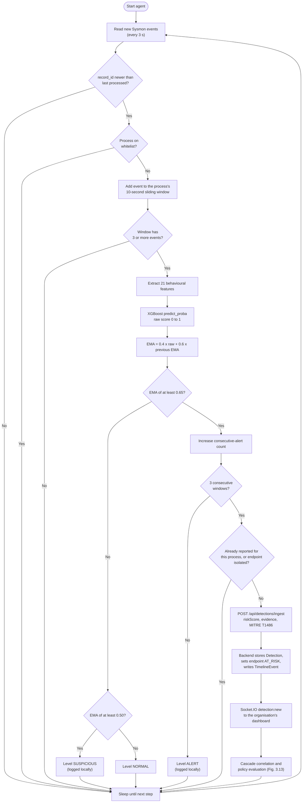

**Explanation.** The flowchart shows the agent's continuous detection loop:

- **Filtering.** New events are filtered by record ID and by a whitelist of noisy system processes, then added to a ten-second sliding window for each process. Windows with fewer than three events are skipped as too sparse.
- **Scoring.** The 21-feature vector is scored by XGBoost, and the score is smoothed with an exponential moving average.
- **Three-level threshold.** At 0.50 the process is SUSPICIOUS, at 0.65 it is ALERT, and after three consecutive ALERT windows it is CRITICAL. Only a CRITICAL level is sent to the backend, and only once per process.
- **Backend handling.** The backend stores the detection, raises the endpoint to AT_RISK and pushes the event to the dashboard.

**Assumptions and limitations.** SUSPICIOUS and ALERT levels are recorded only in the agent's console and CSV log; they are not sent to the backend. If the model file is missing, the agent falls back to a simple heuristic score. Every detection made that way should be treated as a demonstration.

---

### Fig. 3.11 Flowchart: DoS/DDoS Detection

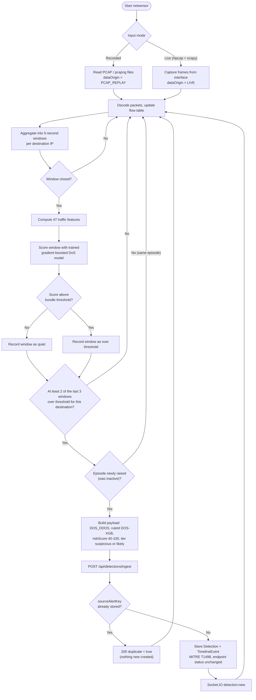

**Explanation.** The network sensor accepts either recorded capture files or live frames, and both paths share the same pipeline:

- **Windowing.** Packets are decoded into flows and aggregated into five-second windows for each destination address. Each closed window yields 47 traffic features.
- **Persistence.** A k-of-n rule (two of the last three windows over the model threshold) prevents single-window noise from raising alerts.
- **One alert per attack.** One detection is raised per *episode*, so a sustained flood produces a single alert instead of one per window.
- **Risk score.** The score, 40–100, combines the threshold margin, persistence and traffic volume. It is a severity measure, not a probability.
- **Backend handling.** The backend rejects duplicates by `sourceAlertKey`, stores the detection with MITRE technique T1498 and notifies the dashboard. It deliberately leaves the endpoint status unchanged.

**Assumptions and limitations.**
- Recorded-PCAP processing is the verified path: three recorded episodes were ingested into the real application.
- The live-capture mode is implemented and its pipeline is unit-tested with an injected frame source, but live detection on a real network was not part of the verified results.
- The backend rejects DoS detections that claim `confidenceTier = confirmed` or come from an untrained detector.

---

### Fig. 3.12 Flowchart: CTI Report Generation and Blockchain Verification

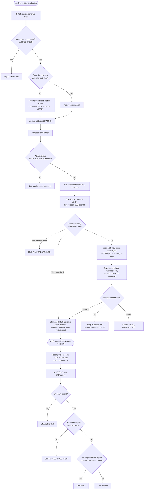

**Explanation.** A CTI report starts when an analyst asks for a draft from a detection, and only attack types with a report template are accepted. Publishing proceeds as follows:

1. The backend atomically locks the report, converts it to canonical JSON (sorted keys, no insignificant whitespace) and hashes it with SHA-256.
2. It saves the hash and transaction hash in MongoDB *before* waiting for the blockchain receipt, so a timeout cannot lose a submitted transaction.
3. It anchors the hash in `CTIRegistry` under the key `keccak256(reportId)`.

During verification, the stored report is re-canonicalised and re-hashed. The result is compared with both the on-chain hash and the stored hash, and the publisher must be the contract owner.

**Assumptions and limitations.**
- **CTI generation is not automatic.** A report is created only when an analyst requests one. The backend does not create reports on its own.
- The diagram simplifies the publish path. It omits the step where a retried request reuses an earlier transaction, and the `UNAVAILABLE` verification result returned when the blockchain RPC cannot be reached.
- An anchored report is changed only by `POST /api/cti/:id/revise`, which creates a new report that *supersedes* the old one.

---

### Fig. 3.13 Flowchart: Incident Response

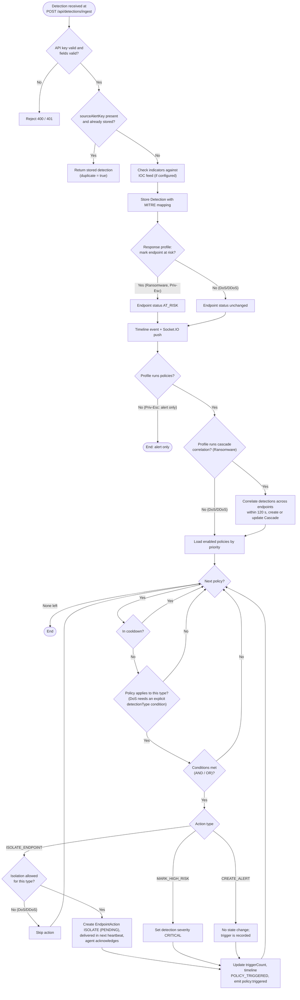

**Explanation.** Incident response starts at the ingestion endpoint:

1. After authentication, validation and duplicate checks, the detection is enriched with IOC matches, stored and pushed to the dashboard.
2. A per-type response profile then decides what happens next. Ransomware detections mark the endpoint at risk, are correlated with detections on other endpoints within a 120-second window into a *cascade*, and are evaluated against the organisation's policies. Privilege-escalation detections are alert-only. DoS/DDoS detections never change endpoint status and never join cascades.
3. Policies are evaluated in priority order, respecting each policy's cooldown period, and their conditions are combined with AND or OR.
4. Matching policies can queue an endpoint isolation, escalate the detection to CRITICAL or record an alert.

`CREATE_ALERT` makes no change of its own, so the policy trigger itself, recorded in the timeline and pushed to the dashboard, is the alert. A hard guard (`isActionAllowed`) refuses isolation for DoS/DDoS detections regardless of how a policy is written. Such detections are also excluded from CTI drafting (Fig. 3.12).

**Assumptions and limitations.**
- **There is no process-termination action.** The implemented response actions are `ISOLATE_ENDPOINT`, `MARK_HIGH_RISK` and `CREATE_ALERT`.
- **Isolation is non-destructive.** The agent's `WindowsSafeDemoIsolationProvider` sets an internal ISOLATED state, acknowledges the command and suppresses further alert reporting, but it intentionally does **not** change firewall rules or disable the network adapter. Real network containment is future work.
- Analysts can also isolate or unisolate an endpoint manually (`POST /api/endpoints/:id/isolate`). That path creates the same `EndpointAction` document.

---

## 3.6 Figure Index

| Figure | Title |
|---|---|
| Fig. 3.3 | Level 0 DFD (Context Diagram) |
| Fig. 3.4 | Level 1 DFD |
| Fig. 3.5 | Use Case Diagram |
| Fig. 3.6 | Component Diagram |
| Fig. 3.7 | Sequence Diagram: Ransomware Detection |
| Fig. 3.8 | Deployment Diagram |
| Fig. 3.9 | Entity-Relationship (Document Reference) Diagram |
| Fig. 3.10 | Flowchart: Ransomware Detection |
| Fig. 3.11 | Flowchart: DoS/DDoS Detection |
| Fig. 3.12 | Flowchart: CTI Report Generation and Blockchain Verification |
| Fig. 3.13 | Flowchart: Incident Response |
